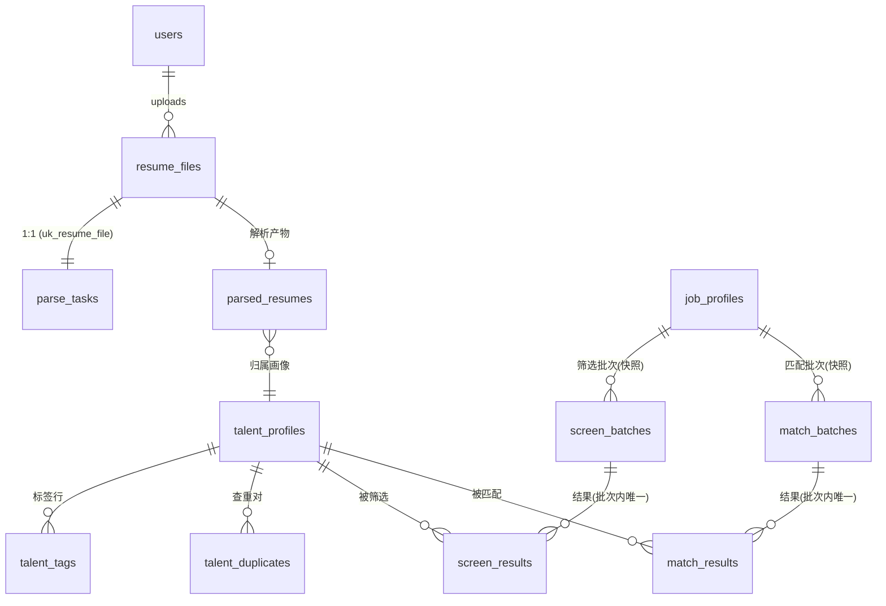

# 数据库设计 · AI 数字化人才平台（精简版）

> 版本：v1.2　|　日期：2026-11-02　|　状态：已确认（第二轮评审回写）
> 上游：`main/需求文档.md`（v1.5）、`main/docs/架构设计.md`（v1.4）、`main/docs/接口设计.md`（v1.3）、《架构评审与修改建议》D-3/D-5/D-6/D-7/D-8。
> 范围：MySQL 业务库 **13 张表** + Milvus collection + 种子数据。`llm_score_cache` 评分缓存表按决策 D-7 **缓办**（设计预留见 §8，B5 联调视 LLM 成本再决定启用）。
> v1.2 变更（决策 D-C/D-D/D-E/D-H/D-I）：①**新增 `sys_settings` 表**（运行时并发等可配项持久化，12→13 张）；②`screen_batches/match_batches` 的 `retry_of_batch_id` **改为 `retry_count`**，retry 统一为「复用原批次」语义并明确复位字段；③`scope_json/talent_scope_json` 增加 **`resolved_ids` 成员快照**，worker 不再重新圈人；④`talent_duplicates.parsed_resume_id` 加 **UNIQUE**（防重试重复挂起）；⑤`parse_tasks` 明确 retry **保留 stage 断点续跑**（§4.2.1）、status 增 `cancelled`、`duplicate_pending` 由 resolve 接口流转；⑥合并语义补 master 默认值、`ability_scores_json` 归属、经历追加规则；⑦§7 向量同步改为按 `profile_text_hash` 触发并明确半写返回口径。

---

## 1. 总体约定

| 项 | 约定 |
|---|---|
| 数据库 | MySQL 8.x，库名 `ai_talent`，字符集 `utf8mb4` / `utf8mb4_unicode_ci`，引擎 InnoDB |
| 主键 | `id BIGINT UNSIGNED AUTO_INCREMENT`，所有表统一 |
| 时间字段 | `created_at DATETIME DEFAULT CURRENT_TIMESTAMP`；需要更新的表加 `updated_at ... ON UPDATE CURRENT_TIMESTAMP`；时间口径 Asia/Shanghai |
| 外键 | **不建物理外键**，关联列建普通索引，一致性由 service 层（同事务）保证 |
| JSON 字段 | 半结构化数据用 `JSON` 类型；**SQLAlchemy 更新 JSON 必须整体重新赋值或用 MutableDict/MutableList**，否则原地修改不落库（隐蔽 bug，代码评审重点） |
| 枚举 | `VARCHAR(20)` + 应用层枚举校验，取值在各表内写死为文档约定 |
| 布尔 | `TINYINT(1)` |
| 分数 | `DECIMAL(5,2)`（0–100）；`vector_similarity` 单独 0–1，不混入维度分数组 |
| 软删除 | 仅 `talent_profiles` 用 `deleted_at`；查询默认过滤 |
| ORM | SQLAlchemy 2.x 同步引擎，`Mapped[]/mapped_column` 风格，模型在 `backend/app/models/` |
| 建表 | `Base.metadata.create_all`（init_db.py，幂等）；一期不引入 Alembic，改表需重建库或手工 ALTER（运行手册明示） |

---

## 2. 表清单与关系



> `sys_settings`（§3.2）为独立 key-value 配置表，无外键关系，不出现在上图中。13 张表 = 上图 12 张 + `sys_settings`。

---

## 3. 用户域

### 3.1 `users`
| 字段 | 类型 | 约束 | 说明 |
|---|---|---|---|
| id | BIGINT UNSIGNED | PK, AI | |
| username | VARCHAR(50) | UNIQUE, NOT NULL | 登录名 |
| password_hash | VARCHAR(100) | NOT NULL | bcrypt |
| display_name | VARCHAR(50) | NULL | |
| role | VARCHAR(20) | NOT NULL, DEFAULT 'hr' | 二期 RBAC 扩展点 |
| is_active | TINYINT(1) | NOT NULL, DEFAULT 1 | 停用→登录/访问 403 |
| last_login_at | DATETIME | NULL | |
| created_at / updated_at | DATETIME | | |

### 3.2 `sys_settings`（运行时可配项，决策 D-C）

| 字段 | 类型 | 约束 | 说明 |
|---|---|---|---|
| id | BIGINT UNSIGNED | PK, AI | |
| setting_key | VARCHAR(50) | **UNIQUE**, NOT NULL | 一期仅 `task_concurrency` |
| setting_value | VARCHAR(255) | NOT NULL | 统一字符串存储，应用层按 value_type 转型 + 范围校验 |
| value_type | VARCHAR(20) | NOT NULL, DEFAULT 'int' | int / bool / str / json |
| description | VARCHAR(255) | NULL | 前端设置项说明文案 |
| updated_by | BIGINT UNSIGNED | NULL | 审计 |
| created_at / updated_at | DATETIME | | |

索引：`uk_setting_key`。

**一期唯一配置项**：`task_concurrency`（int，默认 2，合法范围 **1–5**，越界 400）。

**并发语义（必须按此实现，避免歧义）**：

- 该值是 **TaskRunner 全局任务并发**——解析、筛选、匹配**共用同一个 `ThreadPoolExecutor`**，不是"仅解析并发"。
- **生效机制**：`PATCH /resumes/queue/settings` 只写本表；TaskRunner 每个扫描周期（2s）开始时读取一次，发现与当前值不同则在**无在跑任务时重建线程池**（有在跑任务则等其结束后重建），因此改动最迟一个扫描周期内生效，无需重启。
- **与 `.env` 的关系**：`TASK_CONCURRENCY` 环境变量仅作 `init_db.py` 的**首次种子值**与本表缺行时的兜底；本表有值时**以本表为准**，重启后仍保持。
- `GET /health` 与 `GET /resumes/queue` 返回的 `concurrency` 一律取本表当前值。

---

## 4. 简历与解析域

### 4.1 `resume_files`
| 字段 | 类型 | 约束 | 说明 |
|---|---|---|---|
| id | BIGINT UNSIGNED | PK, AI | |
| filename | VARCHAR(255) | NOT NULL | 原始文件名 |
| stored_path | VARCHAR(500) | NOT NULL | `uploads/2026-11-02/{uuid}.pdf` |
| file_hash | CHAR(64) | NOT NULL, UNIQUE | SHA-256，上传阶段去重 |
| file_ext | VARCHAR(10) | NOT NULL | pdf / docx |
| file_size | INT UNSIGNED | NOT NULL | ≤20MB |
| **upload_batch_id** | CHAR(26) | NOT NULL, IDX | 一次 POST /resumes/batch 一个 ULID（F1-6 筛选范围依据）；**无外键、无批次表**（决策 D-M） |
| uploaded_by | BIGINT UNSIGNED | NOT NULL, IDX | users.id |
| created_at | DATETIME | | |

索引：`uk_file_hash`、`idx_upload_batch`、`idx_uploaded_by`。

> **⚠️ 没有 `upload_batches` 表（决策 D-M，勿改）**：一期 13 张表是冻结口径，批次只是
> `upload_batch_id` 这一个字段的分组。`GET /resumes/batches` 的 `file_count` / `success` /
> `failed` / `uploaded_at` 全部由本表 `GROUP BY upload_batch_id` 实时算出（`uploaded_at`
> = `MIN(created_at)`），`total` 用 `COUNT(DISTINCT upload_batch_id)`。
> 新增批次表会连锁打破：13 张表断言（`app/models/__init__.py`）、`init_db.py` 建表清单、
> `backup_db.py` 备份/恢复行数校验、数据库 §1 的 ER 图与表清单。**不要为了"批次元数据"
> 补表**；确实需要新字段时先按开发日志 §1.3 确认，再改本表。

### 4.2 `parse_tasks`（解析队列，与 resume_files 1:1）
| 字段 | 类型 | 约束 | 说明 |
|---|---|---|---|
| id | BIGINT UNSIGNED | PK, AI | |
| resume_file_id | BIGINT UNSIGNED | NOT NULL, **UNIQUE**（uk_resume_file） | 1:1 当前任务 |
| status | VARCHAR(20) | NOT NULL, DEFAULT 'pending' | pending / running / success / failed / duplicate_pending / **cancelled**（DELETE 队列任务＝置 cancelled，不物理删行） |
| **stage** | VARCHAR(20) | NULL | 失败/进行阶段：extract / profile / vector（定位用） |
| error | TEXT | NULL | 失败原因（含 LLM 原始输出摘要） |
| retries | TINYINT | NOT NULL, DEFAULT 0 | 重试时累加；**`stage` 保留**作为断点续跑起点，仅 `status/error` 重置 |
| truncated | TINYINT(1) | NOT NULL, DEFAULT 0 | 文本截断标记 |
| started_at | DATETIME | NULL | 认领时间 |
| **heartbeat_at** | DATETIME | NULL | 执行中心跳（超时 10 分钟 → 恢复为 pending） |
| **profiled_at** | DATETIME | NULL | 画像生成完成时间 |
| finished_at | DATETIME | NULL | |
| created_at / updated_at | DATETIME | | |

索引：`idx_status`（runner 扫描）。认领：ORM Core `UPDATE ... SET status='running', started_at=NOW(), heartbeat_at=NOW() WHERE id=? AND status='pending'`，按 rowcount 判定。

#### 4.2.1 状态机与重试幂等（**实现必须遵循**）

**状态流转**

```text
pending ──认领──> running ──> success
                    │
                    ├──> failed(stage, error) ──retry──> pending（保留 stage，断点续跑）
                    ├──> duplicate_pending ──resolve──> merge: success ／ keep: pending(stage=profile)
                    └──> cancelled（DELETE 队列任务；──requeue──> pending）
```

- **runner 只消费 `pending` 与心跳超时的 `running`**；`duplicate_pending` 是等人工的状态，**runner 不得扫描**，只能由 `POST /talents/duplicates/{id}/resolve` 流转：
  - `merge`（同步完成）→ `status=success`、`stage=NULL`、`profiled_at=NOW()`、`finished_at=NOW()`；
  - `keep`（202 异步）→ **同步先创建画像空行拿到 `talent_profile_id` 并回填 `parsed_resumes`**（所以接口能同步返回该 id），再置 `status=pending`、`stage='profile'` 交 runner 补 LLM 标签/能力/向量；完成写 `profiled_at/finished_at`，失败落 `failed(stage=profile|vector)` 可 retry。
- **`duplicate_pending` 期间 `profiled_at/finished_at` 均为 NULL**；`success` 时两者必须非空（T-13 验收点「不存在 success 但无画像」的判定依据）。

**断点续跑（保证 parse 重试幂等，决策 D-I）**

worker 认领后**先读 `stage` 与 `parsed_resumes.talent_profile_id`**，据此跳过已完成步骤：

| 入口 stage | 已回填 talent_profile_id | 执行范围 |
|---|---|---|
| NULL / `extract` | — | 文本提取 → LLM 提取 → `parsed_resumes` **按 `resume_file_id` 存在则整体更新**（该列 UNIQUE，严禁插第二行）→ 继续查重 |
| `profile` | 否 | 跳过提取与 LLM 提取，从**查重**开始 |
| `profile` | 是 | 跳过查重与建画像，**按已有落库结果分步子跑**（见下"profile 子步骤跳过"） |
| `vector` | 是 | **只补 embedding + Milvus upsert**，不重跑任何 LLM |

**profile 子步骤跳过（决策 D-G 的 keep/retry 配套）**

`stage='profile'` 且 `talent_profile_id` 已回填时，worker 先查画像表再决定：
- `tags_json` **非空** → 跳过标签 LLM 调用（标签已落库，`uk_profile_tag` 保证重建幂等，但**省一次 LLM 调用**）；
- `ability_scores_json` **非空** → 跳过能力五维 LLM 调用；
- 两者都有 → 直接进入向量阶段；
- 两者都空或部分为空 → 只跑缺失的部分。

> 这是"断点续跑在 profile 内部的进一步细化"：keep 后台标签成功、能力失败后 retry 只补能力；标签+能力都成功、向量失败后 retry 走 `stage='vector'` 路径，profile 阶段不再触发。T-13 验收点补充"stage=profile 重试只调用一次缺失的 LLM（日志核验）"。

**三条硬性防护**

1. **查重自判重**：查重时必须**排除 `parsed_resumes.talent_profile_id` 当前指向的画像**（即本次解析自己刚建的那一个），否则「画像已建 + 向量失败」重试会把同一份简历判成重复人。
2. **孤儿画像**：`INSERT talent_profiles` 与 `UPDATE parsed_resumes.talent_profile_id` **必须同一事务**；事务外崩溃会留下无主画像，重跑再建一个。
3. **重复挂起**：`talent_duplicates.parsed_resume_id` 为 **UNIQUE**（见 §5.3），同一解析结果只能有一条查重记录；重试再次命中重复时**更新原记录**（重置 `status='pending'`、刷新 `matched_value/reason`），不新增行。

**重启恢复与优雅停止**

- 一期单 uvicorn 进程，**启动时不可能有真正在跑的任务**，因此启动即**无条件**把 `running` 重置为 `pending` 并**保留 `stage`**（按断点续跑）；「心跳超 10 分钟恢复」只用于**运行期**任务卡死，不用于启动恢复。
- 优雅停止：优先等待在跑任务完成（超时 `TASK_SHUTDOWN_TIMEOUT`，默认 30s）；超时未完的 `running` 回置 `pending` 并保留 `stage`。

### 4.3 `parsed_resumes`
| 字段 | 类型 | 约束 | 说明 |
|---|---|---|---|
| id | BIGINT UNSIGNED | PK, AI | |
| resume_file_id | BIGINT UNSIGNED | NOT NULL, UNIQUE | |
| talent_profile_id | BIGINT UNSIGNED | NULL, IDX | 初始 NULL，画像创建/合并后回填 |
| structured_json | JSON | NOT NULL | ResumeSchema（见下） |
| raw_text | MEDIUMTEXT | NOT NULL | 截断后文本 |
| llm_model | VARCHAR(100) | NULL | 追溯 |
| created_at | DATETIME | | |

`structured_json`（Pydantic `ResumeSchema` 为准）：
```json
{
  "basic": {"name": "", "gender": "", "birth_year": 0, "phone": "", "email": "", "city": ""},
  "educations": [{"school": "", "major": "", "degree": "", "start": "", "end": ""}],
  "employments": [{"company": "", "title": "", "start": "", "end": "", "description": ""}],
  "skills": [""],
  "projects": [{"name": "", "role": "", "start": "", "end": "", "description": ""}],
  "certificates": [""],
  "expected_title": "",
  "work_years": 0.0
}
```
> `work_years` 以 employments 区间合并计算为准（《算法与判定规则》§2），LLM 给出的数值仅作缺失时兜底。
> **重试写入规则**：`resume_file_id` 为 UNIQUE，解析重试时按该键**存在则整体更新 `structured_json/raw_text/llm_model`**，严禁插入第二行；`talent_profile_id` 的回填与画像创建同事务（见 §4.2.1 防护 2）。
> **实习判定不依赖本 schema**：`employments[]` 无 `is_internship` 字段，实习段由规则层按 `title` 关键词判定（《算法与判定规则》§2.6，决策 D-F）。

---

## 5. 人才画像域

### 5.1 `talent_profiles`
| 字段 | 类型 | 约束 | 说明 |
|---|---|---|---|
| id | BIGINT UNSIGNED | PK, AI | |
| name | VARCHAR(50) | NOT NULL, IDX | |
| gender | VARCHAR(10) | NULL | |
| birth_year | SMALLINT | NULL | |
| phone | VARCHAR(30) | NULL, IDX | 查重键（存规范化值） |
| email | VARCHAR(100) | NULL, IDX | 查重键（存规范化小写值） |
| city | VARCHAR(50) | NULL | |
| degree | VARCHAR(20) | NULL, IDX | **归一化枚举**：博士/硕士/本科/大专/高中中专/其他（规则见《算法与判定规则》§1） |
| work_years | DECIMAL(4,1) | NULL, IDX | 区间合并计算，1 位小数 |
| current_title | VARCHAR(100) | NULL | |
| expected_title | VARCHAR(100) | NULL | |
| skills_json | JSON | NULL | 技能列表（归一化后） |
| tags_json | JSON | NULL | 标签快照，**仅详情页展示冗余**；过滤/统计以 talent_tags 为准 |
| ability_scores_json | JSON | NULL | 五维 `{"professional": {"score": 0, "basis": ""}, ...}`，分值 clamp 0–100 |
| profile_text_hash | CHAR(64) | NULL | 已入 Milvus 的画像文本哈希 |
| **vector_status** | VARCHAR(20) | NOT NULL, DEFAULT 'pending' | pending / synced / failed（双写补偿依据，语义见下方说明） |
| **vector_synced_at** | DATETIME | NULL | |
| source | VARCHAR(20) | NOT NULL, DEFAULT 'resume' | resume / manual |
| **manual_edited_fields** | JSON | NULL | 字段级人工保护清单，如 `["phone", "tags"]`；仅所列字段不被自动解析覆盖 |
| **deleted_at** | DATETIME | NULL, IDX | 软删除标记 |
| **deleted_by** | BIGINT UNSIGNED | NULL | |
| **updated_by** | BIGINT UNSIGNED | NULL | 最近修改人 |
| created_at / updated_at | DATETIME | | |

索引：`idx_name`、`idx_phone`、`idx_email`、`idx_degree`、`idx_work_years`、`idx_updated_at`、`idx_deleted_at`。
`is_manual_edited` 布尔字段**取消**，由 `manual_edited_fields` 是否非空推导。

**`degree` 枚举字面值（唯一口径）**：`博士 / 硕士 / 本科 / 大专 / 高中中专 / 其他`——与《算法与判定规则》§1 归一化值**逐字一致**（注意是「高中中专」，不是「高中/中专」），入库、`job_profiles.min_degree` 校验、`GET /talents?degree=` 过滤都是精确字符串比较。

**`vector_status` 三态语义**：

| 值 | 含义 | 出现场景 |
|---|---|---|
| `pending` | 画像文本已写入 MySQL，尚未 embedding/尚未 upsert | 新建画像事务提交后、向量步骤开始前 |
| `synced` | Milvus 中已有与 `profile_text_hash` 一致的向量 | upsert 成功，同时写 `vector_synced_at` |
| `failed` | MySQL 已提交但 embedding 或 upsert 失败 | Milvus/Embedding 不可用、超时、维度不符 |

- **触发口径**：任何画像写入路径都要**重算画像文本 → 比对 `profile_text_hash` → 变了才 embedding + upsert**（《算法与判定规则》§6.3）。因此改 city/degree/name/title/work_years 同样会刷新向量，**不会**出现「字段已改、向量仍旧、状态还显示 synced」。
- **半写口径（决策 D-B）**：同步接口（`PATCH /talents/{id}`、duplicates `merge`、`restore`、`revector`）里 MySQL 事务已提交但向量失败时，**HTTP 返回 200**，响应体带 `"vector_status": "failed"` 与提示文案，**不返回 503**（业务数据已落库，503 会让前端误判整次操作失败）。补偿途径：`POST /talents/{id}/revector` 或 `scripts/rebuild_vectors.py`。例外：`revector` 自身**没有任何业务写入**，因此 Milvus/Embedding 不可用时返回 **503**。
- 解析流水线中向量失败仍按《架构设计》§5.3 落 `parse_tasks.failed(stage=vector)`，可断点续跑只补向量。

**软删除与恢复（决策 D-H）**：`DELETE /talents/{id}` 写 `deleted_at/deleted_by` 并删除 Milvus 向量（**向量删除失败不阻塞**，返回 `vector_deleted:false`；残留向量无害，语义检索会回查 MySQL 排除软删画像，可由 `rebuild_vectors.py` 清理）；`POST /talents/{id}/restore` 将两者置 NULL、按 `profile_text_hash` 重新 upsert 向量（`vector_status` 走 pending→synced）。恢复后画像重新进入 `all/filter` 圈定范围；历史筛选/匹配结果因外键列未变而自动重新可点开详情。**已软删画像的查询入口**：`GET /talents?deleted=true`（回收站视角，只返回 `deleted_at IS NOT NULL`，按 `deleted_at DESC`），这是 restore 的选取依据——默认列表视角永远看不到它们。

### 5.2 `talent_tags`（标签关联表，决策 D-5）
| 字段 | 类型 | 约束 | 说明 |
|---|---|---|---|
| id | BIGINT UNSIGNED | PK, AI | |
| talent_profile_id | BIGINT UNSIGNED | NOT NULL, IDX | |
| tag | VARCHAR(100) | NOT NULL | 归一化文本（去首尾空格/英文小写/全角转半角） |
| tag_type | VARCHAR(20) | NOT NULL, DEFAULT 'general' | skill / industry / level / general |
| source | VARCHAR(20) | NOT NULL, DEFAULT 'llm' | llm / manual |
| created_at | DATETIME | | |

约束与索引：`uk_profile_tag (talent_profile_id, tag)`、`idx_tag`、`idx_tag_type_tag (tag_type, tag)`。
同步规则：画像创建/更新/人工修正/合并时，**同一事务内**重建该画像的标签行；技能同时写入 `tag_type='skill'`。

### 5.3 `talent_duplicates`（查重待确认）
| 字段 | 类型 | 约束 | 说明 |
|---|---|---|---|
| id | BIGINT UNSIGNED | PK, AI | |
| profile_a_id | BIGINT UNSIGNED | NOT NULL, IDX | 既有画像（**merge 的默认 master，也是 pending 阶段唯一合法 master**，见下方合并语义） |
| profile_b_id | BIGINT UNSIGNED | NULL, IDX | 新画像：`pending` 与 `merge` 场景恒为 **NULL**（新画像尚未创建）；仅 `keep` 场景在同步创建画像后回填 |
| parsed_resume_id | BIGINT UNSIGNED | NOT NULL, **UNIQUE**（uk_parsed_resume） | 触发查重的解析结果（**流水线保证先写 parsed_resumes 再查重**）；一条解析结果只能有一条查重记录，重试再命中时**更新原记录**（重置 status='pending'、刷新 reason/matched_value），不新增行 |
| reason | VARCHAR(50) | NOT NULL | phone_match / email_match / name_phone_match（**hash_match 已删除**——文件哈希在上传阶段拦截） |
| matched_value | VARCHAR(255) | NULL | 命中的规范化值（展示用，手机号脱敏存储） |
| status | VARCHAR(20) | NOT NULL, DEFAULT 'pending' | pending / merged / kept |
| resolution_note | VARCHAR(255) | NULL | 处理备注 |
| resolved_by | BIGINT UNSIGNED | NULL | |
| resolved_at | DATETIME | NULL | |
| created_at | DATETIME | | |

#### 5.3.1 合并语义（merge，同步 ≤2s）

1. **master 归属**：默认且**只能是 `profile_a_id`**。`pending` 阶段 `profile_b_id` 为 NULL，不存在第二个候选画像，因此接口 `master_profile_id` 只接受「省略」或「等于 `profile_a_id`」；传其他值 → **400**。（原「默认最早创建画像 / HR 可任意指定」的表述作废，避免与 `profile_a` 口径冲突。）
2. **标量字段合并**（name/phone/email/city/degree/work_years/current_title/expected_title/gender/birth_year）：master 的 `manual_edited_fields` 所列字段**保持不变**；其余字段按「新解析结果非空值覆盖 master 空值或旧值」合并。
3. **`ability_scores_json`**：**保留 master 原值，不重算、不取新值**。五维评分是 LLM 基于 master 全量历史生成的，合并阶段不重跑 LLM（一期不做合并后重评；如需刷新走画像重算，二期议）。
4. **经历类数组**（educations/employments/projects/certificates，存于 `parsed_resumes.structured_json`，画像详情按 `talent_profile_id` 聚合展示）：合并后所有相关 `parsed_resumes.talent_profile_id` 改指 master，详情页自然聚合多份简历的经历；展示层按 `company + title + start` 去重，**不覆盖、不丢失**任何一段。去重时保留哪条由规则确定：同一组 key 下有差异（如 `end` 或 `description` 不同），**优先保留 `end` 较晚（离今更近）、其次 `description` 字符数更长**的那条——理由是新简历通常补全了旧经历的结束时间和职责描述，代表"信息更完整"的版本。
5. **tags / skills**：取并集（归一化后），**事务内重建** master 的 `talent_tags` 行并刷新 `tags_json`；`source` 保留原有 `manual` 标记不被 `llm` 覆盖。
6. **向量**：按《算法与判定规则》§6.3 重算画像文本 → hash 变化 → embedding → Milvus upsert。LLM 标签**不重跑**。
7. **收尾（同一事务）**：`talent_duplicates.status='merged'` + `resolved_by/resolved_at/resolution_note`；对应 `parse_tasks.status='success'`、`stage=NULL`、`profiled_at/finished_at=NOW()`。
8. **半写处理**：MySQL 事务已提交但第 6 步向量失败 → **HTTP 200** + `vector_status:"failed"`（见 §5.1 半写口径），可用 `POST /talents/{id}/revector` 或 `rebuild_vectors.py` 补偿；**不回滚合并**。

#### 5.3.2 保留语义（keep，202 异步）

1. **同步阶段（接口内完成，因此能返回 `talent_profile_id`）**：为新解析结果创建**独立画像行**——`source='resume'`，标量字段取自 `parsed_resume.structured_json`（学历/年限/技能已归一化），`tags_json/ability_scores_json` 暂为 NULL，`vector_status='pending'`；同事务回填 `parsed_resumes.talent_profile_id` 与 `talent_duplicates.profile_b_id`、`status='kept'`、`resolved_by/resolved_at`；并把 `parse_tasks` 置 `status='pending'`、`stage='profile'`。
2. **异步阶段（TaskRunner 消费）**：按 §4.2.1 断点续跑从 `stage=profile` 开始，补 LLM 标签（10–30）+ 能力五维 + 画像文本 + embedding + upsert；成功写 `profiled_at/finished_at` 与 `status='success'`。
3. **失败可见可重试**：后台失败落 `parse_tasks.failed(stage='profile'|'vector', error)`，在解析队列里正常展示并可 `retry`——**不允许**出现「keep 已返回 202 但画像永远半空且无处重试」。
4. 进度呈现：前端在查重弹窗与解析队列两处都能看到该任务状态（`GET /resumes/queue` 按 `resume_file_id`/`upload_batch_id` 过滤）。

---

## 6. 岗位与筛选/匹配域

### 6.1 `job_profiles`
| 字段 | 类型 | 约束 | 说明 |
|---|---|---|---|
| id | BIGINT UNSIGNED | PK, AI | |
| title | VARCHAR(100) | NOT NULL | |
| department | VARCHAR(100) | NULL | |
| jd_text | TEXT | NOT NULL | 职责描述 |
| requirements_text | TEXT | NOT NULL | 任职要求 |
| min_degree | VARCHAR(20) | NULL | 归一化枚举值 |
| min_work_years | DECIMAL(4,1) | NULL | |
| must_skills_json | JSON | NULL | 必备技能（归一化） |
| bonus_skills_json | JSON | NULL | 加分技能 |
| hard_rule_switches_json | JSON | NOT NULL | `{"degree": true, "work_years": true, "must_skills": true}` |
| pass_threshold | DECIMAL(5,2) | NOT NULL, DEFAULT 75 | 校验 > pending_threshold |
| pending_threshold | DECIMAL(5,2) | NOT NULL, DEFAULT 60 | |
| weights_json | JSON | NOT NULL | `{"skills":40,"experience":30,"education":15,"others":15}` 总和=100（400 校验） |
| **version** | INT | NOT NULL, DEFAULT 1 | 每次 PUT 成功 +1（快照/缓存失效依据） |
| is_active | TINYINT(1) | NOT NULL, DEFAULT 1 | 有批次引用时软删除 |
| **created_by / updated_by** | BIGINT UNSIGNED | NULL | 审计 |
| created_at / updated_at | DATETIME | | |

### 6.2 `screen_batches`
| 字段 | 类型 | 约束 | 说明 |
|---|---|---|---|
| id | BIGINT UNSIGNED | PK, AI | |
| job_profile_id | BIGINT UNSIGNED | NOT NULL, IDX | |
| **job_profile_version** | INT | NOT NULL | 启动时岗位版本 |
| **config_snapshot_json** | JSON | NOT NULL | 岗位条件全量快照（标题/部门/JD/要求/门槛/阈值/权重） |
| scope_json | JSON | NOT NULL | `{"type":"all_unscreened"}` / `{"type":"upload_batch","upload_batch_id":"..."}` / `{"type":"resume_file_ids","ids":[]}` / `{"type":"all"}`（语义见接口设计附录 B）；**创建时追加 `resolved_ids`**（见下方成员快照） |
| status | VARCHAR(20) | NOT NULL, DEFAULT 'pending' | pending / running / done / failed |
| progress | INT UNSIGNED | NOT NULL, DEFAULT 0 | 已完成人数（每完成一人写库） |
| total | INT UNSIGNED | NOT NULL, DEFAULT 0 | |
| passed | INT UNSIGNED | NOT NULL, DEFAULT 0 | |
| **pending_count** | INT UNSIGNED | NOT NULL, DEFAULT 0 | 待定人数（**避免与状态值 pending 同名**，原 pending_cnt 更名） |
| rejected | INT UNSIGNED | NOT NULL, DEFAULT 0 | 含硬淘汰 |
| **started_at / heartbeat_at** | DATETIME | NULL | runner 认领与恢复 |
| **error** | TEXT | NULL | 批次级失败原因 |
| **retry_count** | INT UNSIGNED | NOT NULL, DEFAULT 0 | 重试次数（**取代原 `retry_of_batch_id`**，决策 D-E：retry 一律复用原批次，不存在"新批次指向旧批次"的链路） |
| **vector_degraded** | TINYINT(1) | NOT NULL, DEFAULT 0 | 本批次执行期间向量依赖不可用、已按《算法与判定规则》§4.2 降级（筛选批次恒为 0，见 §4.0） |
| created_by | BIGINT UNSIGNED | NOT NULL | |
| created_at / finished_at | DATETIME | | |

**成员快照（决策 D-D，解决 total/名次漂移）**

- 创建批次时（`POST /screen/batches` 同步阶段）按 scope **解析出确定的 `talent_profile_id` 清单**，写入 `scope_json.resolved_ids`（JSON 数组），并令 `total = len(resolved_ids)`。
- **worker 与 retry 一律只按 `resolved_ids` 执行，禁止重新按 scope 圈人**。因此：
  - 创建时仍在解析的 `upload_batch` 简历**不会**被后续补进本批（它不在快照里）；
  - retry 前新增的画像**不会**被补进来；
  - 快照内画像被软删除时：**已写入的 `screen_results` 行保留**（历史可溯，姓名照显 + "已删除"标记）；**尚未执行的成员由 worker 跳过、不写行**，`done` 时按结果表重算计数（`total` 保持快照值，前端展示 `total` 与 `实际完成数` 两个数字，差值即软删跳过数）。
- 一期规模（千级画像）下 `resolved_ids` 存 JSON 足够；若未来单批超过 5 万 id，再拆 `screen_batch_members` 表（二期议，不影响本期接口）。

**计数口径**：`done` 时按 `screen_results` 重算 `passed/pending_count/rejected`（防漂移）；通过率 = passed / total（total 含硬淘汰，取快照值）。

**retry 复位规则（复用原批次，决策 D-E）**：`status='pending'`、`error=NULL`、`started_at=NULL`、`heartbeat_at=NULL`、`finished_at=NULL`、`retry_count += 1`、`vector_degraded=0`；**`progress` 按已有 `screen_results` 行数重算**（不清零、不等于 total）；`config_snapshot_json`、`job_profile_version`、`scope_json.resolved_ids`、`total` **全部保持不变**。worker 依唯一键 `uk_screen_batch_talent` 只补缺失项，因此「重试后结果行数不变」（T-24 验收点）。

> **批次快照语义（实现必须遵循）**：本批次所有结果 = 执行时的"体检报告"。retry 只补缺、**不重跑已写成员**——即使 retry 前画像被人工 PATCH 过，已写的那条 `screen_result.score` 也不会变。同一人想重新评估 → **另建批次**（scope 选 `all` 自然会按新画像重新评分）。前端"历史批次"详情页需提示"本批次结果为执行时快照，不随画像更新"。

### 6.3 `screen_results`
| 字段 | 类型 | 约束 | 说明 |
|---|---|---|---|
| id | BIGINT UNSIGNED | PK, AI | |
| screen_batch_id | BIGINT UNSIGNED | NOT NULL | **uk_screen_batch_talent (screen_batch_id, talent_profile_id)** 幂等 |
| job_profile_id | BIGINT UNSIGNED | NOT NULL, IDX | 冗余，按岗位查历史 |
| talent_profile_id | BIGINT UNSIGNED | NOT NULL, IDX | |
| hard_fail | TINYINT(1) | NOT NULL, DEFAULT 0 | |
| hard_fail_reason | VARCHAR(255) | NULL | 如"学历不达标：大专 < 本科" |
| score | DECIMAL(5,2) | NULL | **硬淘汰为 NULL**（筛选口径；匹配表用 0） |
| verdict | VARCHAR(20) | NOT NULL | passed / pending / rejected |
| manual_verdict | VARCHAR(20) | NULL | 有效结论 = manual_verdict ?? verdict |
| **manual_verdict_by** | BIGINT UNSIGNED | NULL | 改判操作人 |
| **manual_verdict_at** | DATETIME | NULL | 改判时间（撤销时三者置 NULL） |
| reason_summary | TEXT | NULL | |
| hits_json / misses_json | JSON | NULL | 字符串数组 |
| created_at | DATETIME | | |

索引：`uk_screen_batch_talent`、`idx_batch_verdict (screen_batch_id, verdict)`、`idx_talent`。

### 6.4 `match_batches`
| 字段 | 类型 | 约束 | 说明 |
|---|---|---|---|
| id | BIGINT UNSIGNED | PK, AI | |
| job_profile_id | BIGINT UNSIGNED | NOT NULL, IDX | |
| **job_profile_version** | INT | NOT NULL | |
| **config_snapshot_json** | JSON | NOT NULL | |
| talent_scope_json | JSON | NOT NULL | `{"type":"all"}` / `{"type":"filter","degree":"","min_years":0,"tags":[]}` / `{"type":"upload_batch","upload_batch_id":"..."}`；**创建时追加 `resolved_ids` 成员快照，语义与复位规则同 §6.2**（worker/retry 只按快照执行，禁止重新圈人） |
| status | VARCHAR(20) | NOT NULL, DEFAULT 'pending' | pending / running / done / failed |
| progress / total | INT UNSIGNED | NOT NULL, DEFAULT 0 | `total = len(resolved_ids)`；retry 时 `progress` 按已有结果行数重算 |
| **hard_failed** | INT UNSIGNED | NOT NULL, DEFAULT 0 | 硬淘汰汇总（done 时按结果表重算） |
| **started_at / heartbeat_at** | DATETIME | NULL | |
| **error** | TEXT | NULL | |
| **retry_count** | INT UNSIGNED | NOT NULL, DEFAULT 0 | 重试次数（**取代原 `retry_of_batch_id`**，决策 D-E） |
| **vector_degraded** | TINYINT(1) | NOT NULL, DEFAULT 0 | 本批次曾按《算法与判定规则》§4.2 降级（`vector_similarity=null`），前端需提示结果不可与正常批次直接比较 |
| created_by | BIGINT UNSIGNED | NOT NULL | |
| created_at / finished_at | DATETIME | | |

**排名稳定性补充**：名次由 `hard_fail ASC, score DESC, talent_profile_id ASC` 查询时计算（§6.5），因成员集合已快照固定，**retry 不会导致名次漂移**。快照内画像被软删除时：**已写入的 `match_results` 行保留**（F2-7 历史可溯，姓名照显 + "已删除"标记，详情跳转提示画像已删除）；**尚未执行的成员由 worker 跳过、不写行**，`done` 时按结果表重算 `hard_failed` 等计数，`total` 保持快照值。快照语义同 §6.2：本批次所有结果 = 执行时的体检报告，retry 只补缺、**不重跑已写成员**。

### 6.5 `match_results`
| 字段 | 类型 | 约束 | 说明 |
|---|---|---|---|
| id | BIGINT UNSIGNED | PK, AI | |
| match_batch_id | BIGINT UNSIGNED | NOT NULL | **uk_match_batch_talent (match_batch_id, talent_profile_id)** 幂等 |
| talent_profile_id | BIGINT UNSIGNED | NOT NULL, IDX | |
| score | DECIMAL(5,2) | NOT NULL, DEFAULT 0 | **硬淘汰=0**（匹配口径，决策 D-8） |
| **hard_fail** | TINYINT(1) | NOT NULL, DEFAULT 0 | 应用并标记，不排除 |
| **hard_fail_reason** | VARCHAR(255) | NULL | |
| dimension_scores_json | JSON | NULL | `{"skills":85,"experience":70,"education":90,"others":60}`（0–100）+ `"vector_similarity":0.78`（0–1 单列）；硬淘汰可为 `{}` |
| hits_json / misses_json | JSON | NULL | 硬淘汰者照常生成 |
| reason | TEXT | NULL | |
| created_at | DATETIME | | |

排名规则（**查询时计算，不持久化 rank 列**）：`ORDER BY hard_fail ASC, score DESC, talent_profile_id ASC` + 分页偏移 = 名次；保证稳定与失败批次可展示。

---

## 7. Milvus 向量设计

| 项 | 值 |
|---|---|
| 部署 | 本项目独立 `deploy/milvus/docker-compose.yml`（Standalone + etcd + MinIO，容器名前缀 `aitalent-milvus-*`，独立命名卷）；**严禁指向其他项目数据目录** |
| URI | `MILVUS_URI=http://localhost:19530`（仅此形态，不支持 Lite） |
| 客户端 | pymilvus 3.0.2；开发前四步兼容验证（建 collection/upsert/search/delete） |
| Collection | `talent_vectors`：`talent_profile_id` INT64 PK、`vector` FLOAT_VECTOR（维度=embedding 输出，启动自检）、`text_hash` VARCHAR(64) |
| 度量/索引 | COSINE / AUTOINDEX |
| 画像文本 | 见《算法与判定规则》§6 |
| 同步 | **触发口径**：任何画像写入路径（解析创建 / `PATCH` 任意字段 / merge 合并 / restore 恢复）都**重算画像文本 → 比对 `profile_text_hash` → 变了才 embedding + upsert + `vector_status=synced`**（《算法与判定规则》§6.3）；软删除 → delete 向量（`profile_text_hash` 保留，restore 据此重建）；**失败分场景**：解析流水线 → `parse_tasks.failed(stage=vector)` 断点续跑只补向量；同步接口（PATCH/merge）→ **HTTP 200 + `vector_status=failed`**（§5.1 半写口径，不回滚业务数据）；补偿 → `POST /talents/{id}/revector` 或 `rebuild_vectors.py` |
| 降级 | **Milvus 或 Embedding 任一不可用**：语义检索 503；匹配批次按《算法与判定规则》§4.2 降级（`experience=llm_experience`、`vector_similarity=null`、批次 `vector_degraded=1`）不失败；**筛选批次不含相似度项，分数与结论完全不受影响**（§4.0）；解析任务落 `failed(stage=vector)`；普通 CRUD 的 MySQL 写入照常成功 |
| 备份 | 向量属派生数据，不入备份，可全量重建 |

---

## 8. 缓办项设计预留：`llm_score_cache`（决策 D-7）

一期**不建表、不实现**；适配层预留 cache 钩子。若 B5 联调后 LLM 成本/速度成为问题，按以下设计启用（表 13 → 14）：

| 字段 | 类型 | 说明 |
|---|---|---|
| id | BIGINT UNSIGNED PK | |
| cache_key | CHAR(64) UNIQUE | `SHA256(scene｜job_profile_id｜job_profile_version｜profile_text_hash｜prompt_version｜model｜normalized_weights_or_thresholds)` |
| scene | VARCHAR(30) | screen / match / parse / profile |
| job_profile_id / job_profile_version / talent_profile_id / profile_text_hash | — | 失效维度 |
| prompt_version / model | VARCHAR | 提示词/模型版本 |
| output_json | JSON | 评分/标签/理由结果 |
| created_at | DATETIME | |

失效规则：岗位改版（version+1）、画像文本变化、换模型、改提示词 → miss。评测运行禁用缓存。

---

## 9. 种子数据（init_db.py，幂等）

1. **用户**：`hr / hr123456`（bcrypt，role=hr，is_active=1）
2. **示例岗位条件**（version=1）：高级后端工程师；本科；3 年；必备 `["python","fastapi","mysql"]`（归一化小写）；加分 `["milvus","docker"]`；门槛全开；阈值 75/60；权重 40/30/15/15
3. **运行配置**：`sys_settings` 写入 `task_concurrency`（value=`.env` 的 `TASK_CONCURRENCY`，缺省 `2`；value_type=`int`；description=`TaskRunner 全局任务并发（1-5）`）
4. 重复执行跳过已存在数据，不删除不覆盖（`sys_settings` 已存在则**保留现值**，不用 `.env` 覆盖用户改过的并发）。

---

## 10. 备份与数据目录

- `scripts/backup_db.py`（Python 实现，Windows 直接运行；调用 mysqldump 或 ORM 导出 SQL）→ `backups/ai_talent_YYYYMMDD.sql`
- 上传文件存 `data/uploads/`（git 忽略），DB 只存相对路径；迁移时文件目录 + SQL 备份 + Milvus 重建脚本三件套
- `scripts/rebuild_vectors.py`：遍历未删除画像重算文本 → embedding → upsert
- `scripts/check_env.py`：MySQL/Milvus/LLM/Embedding 连通性与版本自检

---

## 11. 与需求文档实体对照（v1.5 §5）

| 需求实体 | 本文档表 | 变更说明 |
|---|---|---|
| users | users | 一致 |
| —— | **sys_settings** | **v1.2 新增（D-C）**：运行时并发等可配项持久化，13 张表 |
| resume_files | resume_files | +upload_batch_id |
| parse_tasks | parse_tasks | +stage/heartbeat_at/profiled_at、uk_resume_file；**v1.2**：status 增 `cancelled`，retry 保留 stage 断点续跑（§4.2.1） |
| parsed_resumes | parsed_resumes | 一致（talent_profile_id 初始 NULL）；**v1.2**：重试按键整体更新，不插第二行 |
| talent_profiles | talent_profiles | +vector_status/vector_synced_at/manual_edited_fields/deleted_at/deleted_by/updated_by；取消 is_manual_edited；**v1.2**：degree 枚举字面值锁死、vector_status 三态与半写口径、restore 恢复 |
| talent_tags | talent_tags | 新增表（D-5） |
| talent_duplicates | talent_duplicates | reason 删 hash_match；+matched_value/resolution_note；**v1.2**：`parsed_resume_id` 加 UNIQUE、master 口径统一为 profile_a（§5.3.1/§5.3.2） |
| job_profiles | job_profiles | +version/created_by/updated_by |
| screen_batches | screen_batches | +job_profile_version/config_snapshot_json/started_at/heartbeat_at/error；pending_cnt→pending_count；**v1.2**：`retry_of_batch_id`→**`retry_count`**、+`vector_degraded`、`scope_json.resolved_ids` 成员快照 |
| screen_results | screen_results | +manual_verdict_by/at、uk_screen_batch_talent |
| match_batches | match_batches | +快照/心跳/重试字段、hard_failed；**v1.2**：`retry_of_batch_id`→**`retry_count`**、+`vector_degraded`、`talent_scope_json.resolved_ids` |
| match_results | match_results | +hard_fail/hard_fail_reason、uk_match_batch_talent；**删除持久化 rank 列（查询时计算）** |
| （缓办） | llm_score_cache | 设计预留，一期不建（D-7）；启用后表数 13→14 |
