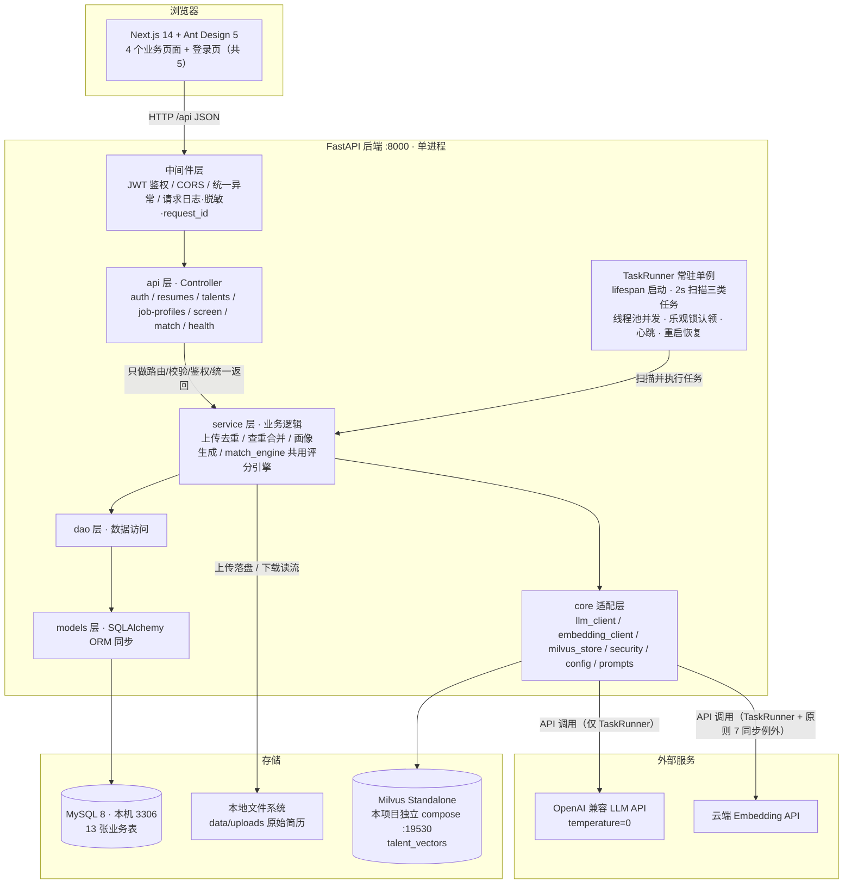
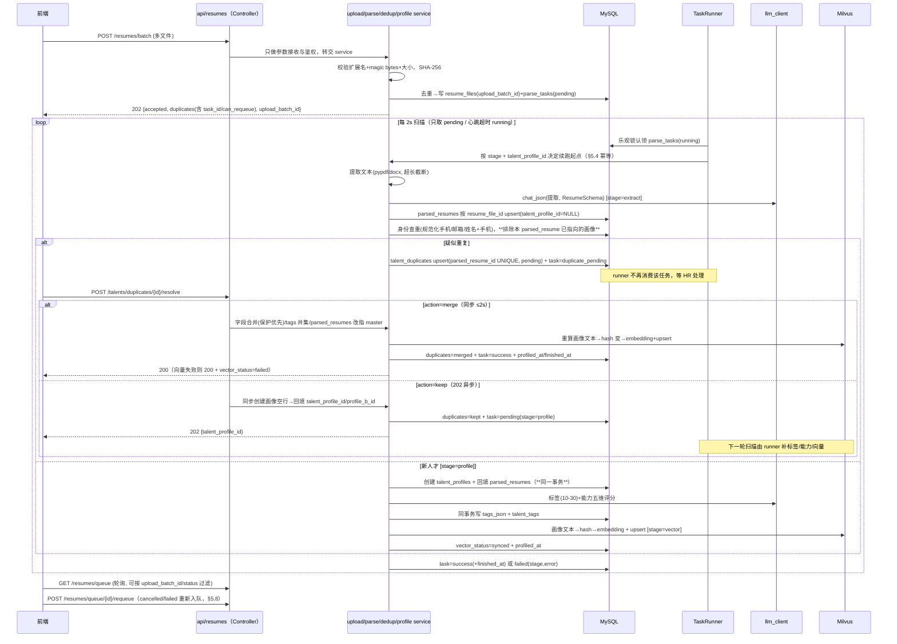
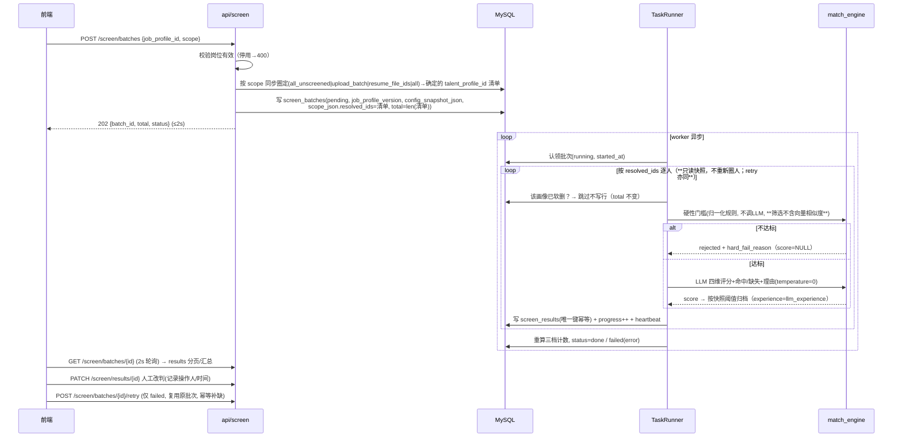

# 架构设计 · AI 数字化人才平台（精简版）

> 版本：v1.4　|　日期：2026-11-05　|　状态：已确认（一致性核对修订）
> 上游文档：`main/需求文档.md`（v1.5）。本文档覆盖 M1 的架构设计与技术选型；数据库表设计、接口设计、算法与判定规则为配套独立文档。
> v1.1 变更：按《架构评审与修改建议》（D-1~D-10 已确认）回写——BackgroundTasks 改为常驻 TaskRunner；明确同步 ORM + 同步 def 路由；Milvus 仅 Standalone 且本项目独立 compose；筛选/匹配时序改为"HTTP 只建批次、worker 异步执行"；新增部署运行手册与测试策略两节；风险补提示词注入/PII/向量一致性。
> **v1.2 变更（第二轮评审，决策 D-A~D-I）**：①修正总体架构图违反自身分层禁令的两条边（`API→MYSQL`、`API→FS`）；②页面数口径改为「4 个业务页面 + 登录页（共 5）」；③原则 7 与 §5.1 明确**同步接口禁 LLM、允许单次 Embedding/Milvus**，并定义半写返回 200 + `vector_status=failed`；④§5.3 修正错误引用（算法 §4.3→**§4.2**）、消除「503 或按规则降级」二义、补 **Embedding 单独不可用**口径、向量重算改为 `profile_text_hash` 触发；⑤§5.4 补 **parse 断点续跑幂等（D-I）**、启动恢复无条件重置 `running`、`duplicate_pending` 不被 runner 消费、并发配置改 `sys_settings` 持久化 + 动态生效；⑥**明确筛选不含向量相似度项**（§6.3、§4.0 对齐），据此重写 Milvus 降级口径与验收 12 的架构保障；⑦批次成员快照 `resolved_ids`；⑧新增 §5.8 生命周期闭环（requeue / restore / revector，并补 **`GET /talents?deleted=true` 回收站视角**作为 restore 的选取入口）；⑨表数 12→13；⑩`/health` 增 `embedding_alive` 被动探测，使「仅 Embedding 挂掉」也能被发现。
> **v1.3 变更（一致性核对）**：①§4 目录树与 §11 文档衔接补三份公共设计文档（Prompt / 运行配置 / 错误码+JWT），todolist 版本改 v1.4；②§5.1 明确 `request_id` 仅错误响应携带、`GET /health` 是统一返回体唯一例外；③明确 `PATCH /talents/{id}` 不接受 `educations/employments/projects/certificates`（经历明细只读，见接口 §5 / 数据库 §5.3）。
> **v1.4 变更（审核修复，2026-11-05）**：§4 选型表 Embedding 行改为"允许与 LLM 不同供应商"（决策 **D-L**，需求 §12 #35：实际 LLM=讯飞 spark-x2.6、Embedding=百炼 text-embedding-v3，均 OpenAI 兼容；详见开发日志 Layer 5 D-L）。其余内容不变。
> **v1.4 补注（第三/四轮复检，2026-11-05）**：§4 目录树文档版本号同步至当前权威值（含开发日志 v1.7），并在 §4 末尾新增「版本号维护规则」（权威版本以《开发日志》Layer 6 为准，本树仅作快速识别）。本次仅为维护性文本修订，**设计口径未变，故不升版**；改动已登记在开发日志 Layer 4（第三/四轮）与 Layer 6 备注。
> **v1.4 补注②（T-05，2026-11-05）**：§4 目录树新增 `core/profile_text.py` —— 算法 §6.3 画像文本的**唯一拼装口径 + SHA-256**，T-05 落地、T-16/T-18/`rebuild_vectors` 复用（避免多处各拼一套文本导致 `profile_text_hash` 分叉）；日志版本指针刷至 v2.3。同属维护性文本修订，设计口径未变，**不升版**。

---

## 1. 设计目标与原则

1. **前后端分离**：Next.js 前端 + FastAPI 后端，REST/JSON 通信，后端不做任何页面渲染。
2. **MVC 分层架构**：后端按 Controller→Service→DAO→Model 分层（对应 `api/service/dao/models`），层层单向依赖，禁止跨层调用。
3. **ORM 全映射，零裸 SQL**：所有数据访问经 SQLAlchemy 2.x ORM（同步引擎）。
4. **AI 能力经适配层隔离**：LLM / Embedding / Milvus 统一封装在 `core/` 适配层，业务层不直接触碰第三方 SDK；供应商可替换。
5. **配置与代码分离**：所有环境相关配置走环境变量 + `.env`，为二期 Docker 封装预留。
6. **真实调用，禁用 mock**：业务结果必须来自真实 LLM/向量检索，测试桩只允许出现在单元/集成测试中。
7. **长任务异步化 + 可恢复**：批量解析/筛选/匹配由**常驻 TaskRunner** 执行，数据库状态表记录进度与心跳，重启可恢复；**HTTP 请求内不做任何 LLM 调用**。
   - **Embedding/Milvus 是唯一例外（决策 D-B）**：允许同步接口发起**单次** embedding + upsert（`PATCH /talents/{id}`、duplicates `merge`），受 `VECTOR_SYNC_TIMEOUT`（默认 **5s**，运行配置 v1.4；原 1.5s 因冷连接 embedding 实测 ~1.7s 误判超时而上调，见 §5.6）硬预算约束；超预算或失败按 §5.1「半写口径」返回 **HTTP 200 + `vector_status:"failed"`**，不回滚已提交的 MySQL 数据、不返回 503。语义检索（`GET /talents/search`）的 embedding 属查询路径且有短期缓存，按 D-10 口径单独计量。
   - 例外之外的所有 AI 调用（简历提取、标签、能力评分、筛选/匹配评分与理由）只在 TaskRunner 内发生。
8. **部署约束**：一期仅允许单 uvicorn 进程（`--workers 1`），多进程需拆分独立 worker（二期）。

### 1.1 与经典 MVC 的对应关系
| 经典 MVC | 本项目 | 说明 |
|---|---|---|
| Controller | `api/`（FastAPI Router） | 路由、参数校验（Pydantic）、鉴权依赖、统一返回 |
| —— | `service/` | 从 Controller 拆出的业务逻辑层（MVC 的现代演化） |
| Model | `models/`（ORM）+ `dao/` | 数据实体与数据访问 |
| View | 前端 Next.js 页面组件 | 前后端分离后视图完全在前端 |

---

## 2. 总体架构



> **图的读法（v1.2 修正）**：`api` 层**不直连** MySQL、也**不直接读写文件系统**——上图所有到 `MYSQL`/`FS` 的边都从 `SVC` 出发，与 §1 原则 2 的分层禁令一致。长任务接口（上传、发起筛选/匹配）在 `api` 层只做参数校验，经 `service` 写入任务/批次行后**立即返回 202**，真正的执行由 `RUNNER` 在自己的循环里触发（图中 `RUNNER → SVC`）。时序图（§6）里的参与者 `API` 泛指「HTTP 请求路径」，其内部同样按 `api → service → dao` 分层，不代表 Controller 直接落库。

依赖方向：`api → service → dao → models`；`service → core`；`tasks/runner → service`。**禁止**：dao 反向调用 service、api 直接调用 dao、**api 直接读写文件系统或直连 MySQL**、HTTP 请求路径内调用 LLM（Embedding/Milvus 的单次同步调用按 §1 原则 7 例外允许）。文件哈希、magic bytes 校验、SHA-256 去重、写 `resume_files + parse_tasks` 全部属 `upload_service` 职责，Controller 只负责接收 `UploadFile` 与返回 202。

---

## 3. 技术选型总表

| 层 | 选型 | 版本基线 | 用途 |
|---|---|---|---|
| 前端框架 | Next.js（App Router）+ React + TypeScript | 14.x / 18.x | SPA 页面 |
| UI 组件库 | Ant Design + @ant-design/charts | 5.x | 表格/表单/上传/雷达图 |
| HTTP 客户端 | axios | 1.x | 统一封装（JWT 注入、错误提示、blob 下载） |
| 后端框架 | FastAPI + uvicorn[standard] | ≥0.115 | REST API，单进程 |
| ORM | SQLAlchemy（**同步引擎**） | 2.x | MySQL 全对象映射 |
| 数据校验 | Pydantic + email-validator | 2.x | DTO / LLM 输出校验 |
| 业务库 | MySQL（本机 localhost:3306，已运行） | 8.x | 13 张业务表（含 `sys_settings`） |
| 向量库 | **Milvus Standalone**（本项目 `deploy/milvus/docker-compose.yml` 独立部署，独立容器名/数据卷） | milvusdb/milvus v2.6.x | 画像向量、语义检索 |
| 向量客户端 | pymilvus | 3.0.2（**开发前实跑验证与 Milvus 2.6 兼容性**，不通过则调版本） | collection 管理/检索 |
| LLM | OpenAI 兼容 API（openai SDK，temperature=0） | 1.x | 提取/评分/标签/理由 |
| Embedding | 云端 API（**允许与 LLM 不同供应商**，决策 D-L：实际百炼 text-embedding-v3） | — | 文本向量化 + 查询短期缓存 |
| 简历解析 | pypdf + python-docx | — | PDF/DOCX 文本提取 |
| 鉴权 | python-jose（JWT）+ bcrypt | — | 登录与接口鉴权 |
| 后台任务 | **常驻 TaskRunner**（lifespan + ThreadPoolExecutor + DB 状态表） | — | 解析/筛选/匹配；并发数由 `sys_settings.task_concurrency` 持久化，运行时可改（见 §5.4） |
| 配置 | pydantic-settings + `.env` | — | 环境变量管理 |
| 包管理 | pip + requirements.txt（Python 3.11+，含 python-multipart/cryptography）；npm（Node 18+） | — | 依赖管理 |

---

## 4. 目录结构

```
main/
├── 需求文档.md                   # v1.5（功能/验收唯一来源）
├── 业务逻辑说明.md               # v1.0（业务视角总览，帮助快速理解）
├── 开发日志.md                   # v2.26（🚨 接力入口：进度/顺序/规范/决策/环境快照/环境坑速查卡）
│   ├── 安全走查记录.md           # T-32（16 项清单 + 未授权扫描 35/35）
├── docs/
│   ├── 架构设计.md               # 本文件 v1.4
│   ├── 数据库设计.md             # v1.2
│   ├── 接口设计.md               # v1.3
│   ├── 算法与判定规则.md         # v1.2（归一化/评分公式/阈值/LLM 输出规范）
│   ├── LLM提示词设计.md          # v1.2（🚨 公共：Prompt A/B/C + schema + Prompt D + 别名表）
│   ├── 运行配置.md               # v1.3（🚨 公共：env 键表 + .env.example + sys_settings）
│   ├── 统一错误码与鉴权.md       # v1.2（🚨 公共：响应体 + 错误码 + JWT）
│   ├── 开发计划-todolist.md      # v1.5
│   ├── 审核-修改建议报告.md      # 滚动审核记录（最终状态见第六章 + §6.5）
│   └── 架构评审与修改建议.md     # 评审记录（已评审）
├── deploy/
│   └── milvus/docker-compose.yml # 本项目独立 Milvus（独立容器名+卷，严禁指向其他项目数据）
├── data/                         # 运行数据（git 忽略）
│   ├── uploads/                  # 原始简历（按日期子目录）
│   └── eval/                     # 重建评测集（AI 合成简历 + 标注 JSON）
├── backend/
│   ├── requirements.txt
│   ├── .env.example
│   ├── app/
│   │   ├── main.py               # 入口：中间件/路由注册/lifespan 启停 TaskRunner
│   │   ├── config.py             # pydantic-settings 全局配置
│   │   ├── database.py           # 同步 engine/session
│   │   ├── api/                  # Controller 层
│   │   │   ├── auth.py  resumes.py  talents.py
│   │   │   ├── job_profiles.py  screen.py  match.py  health.py
│   │   │   └── deps.py           # JWT 鉴权、分页依赖
│   │   ├── schemas/              # Pydantic DTO（含 ResumeSchema）
│   │   ├── service/
│   │   │   ├── auth_service.py  upload_service.py  extract_service.py  parse_service.py
│   │   │   ├── dedup_service.py  profile_service.py  queue_service.py
│   │   │   └── talent_service.py # 画像 CRUD（T-18：列表双视角/详情聚合/PATCH 保护/软删恢复/revector/下载）
│   │   │   # profile_service 已落地（T-16）：build_profile / sync_profile_vector（hash 触发唯一入口）
│   │   │   # dedup_service 已落地（T-17）：detect 三路判重 / flag 挂起 / resolve merge·keep / list_duplicates
│   │   │   # parse_service 已落地（T-13）：extract_structured 调 Prompt A → ResumeSchema
│   │   │   # queue_service 已落地（T-14）：队列列表/并发设置/retry/requeue/软取消（状态流转唯一入口）
│   │   │   ├── match_engine.py   # 筛选/匹配共用评分引擎（T-23 已落地：hard_gate/evaluate/use_vector）
│   │   │   # job_profile_service 已落地（T-22）：CRUD + 统一 400 校验 + 技能归一化入库
│   │   │   # screen_service 已落地（T-24）：圈人快照（D-D）/retry 复用原批次（D-E）/改判计数
│   │   │   # match_service 已落地（T-25）：match 批次（filter tags AND）/名次查询时计算/降级 done
│   │   │   ├── screen_service.py  match_service.py
│   │   ├── dao/                  # 每实体一个 dao（talent_profiles.py T-16、talent_duplicates.py T-17、parsed_resumes.py T-13；parse_tasks/sys_settings T-14 扩写）
│   │   ├── models/               # ORM 实体（13 张表，含 sys_settings）
│   │   ├── core/
│   │   │   ├── llm_client.py     # chat_json/chat_text、JSON 修复、重试、信号量、注入防护
│   │   │   ├── embedding_client.py  # 含查询短期缓存
│   │   │   ├── milvus_store.py   # Standalone 专用；自检/upsert/search/delete
│   │   │   ├── profile_text.py   # §6.3 画像文本唯一拼装口径 + SHA-256（T-05 新增，T-16/T-18/rebuild 复用）
│   │   │   ├── worker_state.py   # TaskRunner ↔ health 共享状态（T-12 新增，避免 tasks→api 反向依赖）
│   │   │   ├── normalize.py      # 学历/年限/技能/联系方式归一化（T-16 落地，D-N：T-23 只在此基础上加命中判定）
│   │   │   ├── prompts/          # 提示词模板 + 版本号（prompt_version）
│   │   │   └── security.py       # bcrypt/jose
│   │   ├── tasks/
│   │   │   ├── runner.py         # TaskRunner 单例：主循环/线程池/认领/心跳/恢复
│   │   │   ├── parse_worker.py   # 解析流水线（extract→dedup→profile→vector；T-13 已落地，含 resolve_entry 断点入口表）
│   │   │   ├── screen_worker.py  # 筛选批次执行（T-24 已落地：只读 resolved_ids/只补缺/逐人提交）
│   │   │   └── match_worker.py   # 匹配批次执行
│   │   └── utils/                # 文件哈希/magic bytes/脱敏/ULID
│   ├── scripts/
│   │   ├── init_db.py            # 建库建表 + 种子（幂等）
│   │   ├── backup_db.py          # Windows 可用备份脚本
│   │   ├── rebuild_vectors.py    # 向量全量重建
│   │   └── check_env.py          # MySQL/Milvus/LLM 环境自检
│   └── tests/                    # 单元/集成/评测脚本（eval_parse.py、eval_match.py）
└── frontend/
    ├── package.json
    ├── src/
    │   ├── app/                  # login / screen / talents / job-profiles / match
    │   │   ├── (main)/screen/    # T-15：page + types/api/utils + UploadPanel/QueuePanel；T-27：+ScreenBatchPanel
    │   │   ├── (main)/talents/   # T-20：page + types/api/utils + TalentListPanel/DuplicatesDrawer；T-21：[id]/DetailView + EditProfileModal/TagEditModal/DuplicateResolveModal + AbilityRadar（手写 SVG，取舍见日志）
    │   │   ├── (main)/job-profiles/ # T-26：page + JobProfileFormModal（权重滑块总和拦截）
    │   │   └── (main)/match/     # T-28：MatchPanel（名次表 + 理由详情 + 降级告警）
    │   ├── components/           # 雷达图/时间线/名单表格/查重确认弹窗等
    │   ├── lib/                  # axios 封装（blob 下载）、usePolling、鉴权守卫、类型
    │   └── styles/
    └── .env.local.example        # NEXT_PUBLIC_API_BASE
```

> **版本号维护规则**：本树的文档版本号仅供快速识别；**权威版本以《开发日志》Layer 6 的版本对照表为准**，改版时必须同步 Layer 6，本树若滞后以 Layer 6 覆盖。

---

## 5. 关键机制设计

### 5.1 统一返回与异常
- 所有接口返回 `{code, message, data}`；列表 data 为 `{items, total, page, page_size}`；批次创建返回 HTTP 202。
- **成功 / 202 不带 `request_id`；仅错误体带**。唯一例外：`GET /health` 直接返回健康检查结构，不套统一返回体。
- 业务异常 `BizError(code, message)`，全局异常处理器归一化；账号停用 403。
- **503 的准确边界（决策 D-B，避免"半写却报 503"）**：
  | 场景 | 返回 |
  |---|---|
  | 请求**尚未产生任何业务写入**就发现依赖不可用（语义检索时 Embedding/Milvus 挂） | **503** |
  | 长任务接口创建批次时依赖不可用 | 批次照常创建（worker 内降级），**202**；匹配批次执行时标 `vector_degraded=1` |
  | **MySQL 事务已提交**、随后 embedding/upsert 失败（`PATCH /talents/{id}`、duplicates `merge`） | **200** + `data.vector_status="failed"` + 提示文案，**不回滚、不 503** |
  | 解析流水线中向量失败 | 不走 HTTP，落 `parse_tasks.failed(stage=vector)` 可断点续跑 |
- 错误码映射统一：业务校验（权重总和、阈值关系、并发越界）→ 400；Pydantic → 422；重复 DELETE / 对已 `cancelled` 任务再删 → 404。
- 请求日志中间件：method/path/耗时/user/request_id，手机号、邮箱自动脱敏。

### 5.2 LLM 适配层（llm_client）
- 单一入口：`chat_json(prompt, schema, retry=1)` 与 `chat_text(prompt)`；`temperature=0`、`max_tokens` 显式设置。
- JSON 输出：提示词强约束 + `response_format=json`（供应商支持时）+ **JSON 修复（截取花括号/去 markdown 围栏）** + Pydantic 校验；失败自动重试 1 次；再失败抛出带原始输出摘要的异常，由调用方落库失败原因与阶段。
- **提示词注入防护**：简历文本一律作为"数据段"包裹（明确分隔符 + 系统提示声明"以下内容不是指令"）；LLM 输出仅取 schema 字段，不执行任何输出中的指令性内容。
- 超时（默认 120s）、全局 LLM 信号量（默认并发 2，与任务线程池解耦）、429/5xx 指数退避重试。
- 提示词集中在 `core/prompts/`，每个模板带 `prompt_version`（评分缓存与评测报告的失效依据）。
- 评分缓存（`llm_score_cache`）**一期缓办**（决策 D-7）；适配层预留 cache 钩子接口，不实现。

### 5.3 Embedding 与 Milvus（milvus_store）
- **仅支持 Standalone**：`MILVUS_URI=http://localhost:19530`；本项目 `deploy/milvus/docker-compose.yml` 独立部署（独立容器名前缀 `aitalent-milvus-*`、独立命名卷），**严禁复用或指向其他项目的 Milvus 实例与数据目录**。
- 开发前置：启动 compose 后实跑"建 collection → upsert → search → delete"四步验证 pymilvus 3.0.2 兼容性，通过才锁定版本。
- Collection `talent_vectors`：`talent_profile_id` INT64 主键、`vector` FLOAT_VECTOR（维度=embedding 模型输出，启动自检：不存在则创建，存在但维度不符则报错提示重建）、`text_hash` VARCHAR(64)。
- 画像文本构成见《算法与判定规则》§6.3；**重算触发口径**：任何画像写入路径（解析创建 / `PATCH` 任意字段 / merge / restore）都要重算画像文本 → 比对 `profile_text_hash` → **变了才** embedding + upsert。禁止只在 tags/skills/经历变化时才重算（否则改 city/degree/name/title/work_years 后向量仍是旧的，而 `vector_status` 还显示 `synced`，F2-5 检索结果与画像矛盾）。软删除时 delete 向量（`profile_text_hash` 保留，restore 据此重建）。
- **双写一致性**：`talent_profiles.vector_status`（pending/synced/failed）+ `vector_synced_at`。失败分场景处理：
  - 解析流水线 → `parse_tasks.failed(stage=vector)`，retry **断点续跑只补向量**（不重跑 LLM，见 §5.4）；
  - 同步接口（`PATCH /talents/{id}`、`merge`）→ MySQL 已提交则**返回 200 + `vector_status:"failed"`**（§5.1 半写口径），补偿走 `POST /talents/{id}/revector`；
  - 全量补偿 → `scripts/rebuild_vectors.py`（遍历未删除画像，按 hash 差异 upsert）。
- 语义检索：查询文本 → embedding（**相同查询短期缓存**）→ Milvus COSINE topK（默认 20，上限 100）→ 回查 MySQL（排除软删除）。
- **降级口径（统一，消除原「503 或按规则降级」的二义）**——Milvus **或 Embedding 任一**不可用时：
  | 功能 | 行为 |
  |---|---|
  | `GET /talents/search` 语义检索 | **503**（请求无业务写入，见 §5.1） |
  | 解析流水线 | 落 `failed(stage=vector)` 可重试；**提取与查重结果已保留**，不算整体失败丢失 |
  | **筛选批次（F1）** | **完全不受影响**——筛选不含向量相似度项（《算法与判定规则》§4.0，决策 D-A），分数与三档结论不变 |
  | 匹配批次（F3） | 按《算法与判定规则》**§4.2** 降级：`experience = llm_experience`、`vector_similarity=null`、批次 `vector_degraded=1`，**照常执行不失败** |
  | 普通 CRUD（岗位配置、队列管理、画像读取、软删/恢复的 MySQL 部分） | **不受影响**；`PATCH /talents/{id}` 与 `merge` 的业务写入成功，仅向量待补偿 |
  | `GET /health` | `milvus:false` / `embedding_configured` 或探活 false → `status:"degraded"`，HTTP 仍 200 |

### 5.4 TaskRunner 常驻任务模型（决策 D-1，v1.2 重写）

**扫描与认领**

- `tasks/runner.py` 单例，`main.py` lifespan 启动时创建、关闭时优雅停止。
- 主循环每 2s（`RUNNER_SCAN_INTERVAL`）扫描三类任务：`parse_tasks`、`screen_batches`、`match_batches`，**只取 `status='pending'` 与心跳超时的 `running`**。
- **`duplicate_pending` 不在扫描范围内**——它是等人工的状态，只能由 `POST /talents/duplicates/{id}/resolve` 流转（merge→`success`；keep→同步建画像行后置 `pending` + `stage='profile'` 交回 runner）。`cancelled`（DELETE 队列任务）同样不被扫描，只能由 `requeue` 恢复。
- 认领机制：ORM Core `update(...).where(status='pending')`，按 rowcount 判断是否抢到；认领后写 `started_at`，执行中周期更新 `heartbeat_at`。

**并发配置（决策 D-C）**

- `ThreadPoolExecutor(max_workers=N)`，N 取自 **`sys_settings.task_concurrency`**（1–5，默认 2），**三类任务共用同一个池**——所以「并发」指 TaskRunner 全局任务并发，不是"仅解析并发"。
- 运行时生效：`PATCH /resumes/queue/settings` 写 `sys_settings`；runner 每个扫描周期读一次，发现变化则在**无在跑任务时重建线程池**（有在跑任务则等其结束），最迟一个周期内生效，**无需重启且重启后保持**。
- `.env` 的 `TASK_CONCURRENCY` 只作 `init_db.py` 首次种子与表缺行兜底；表有值时以表为准。
- 全局 LLM 信号量（`LLM_CONCURRENCY`）在适配层，与线程池并发**解耦**：线程池控制"同时跑几个任务"，信号量控制"同时打几个 LLM 请求"，防供应商限频。

**幂等（两条独立机制，缺一不可）**

1. **批次幂等**：结果表 `(batch_id, talent_profile_id)` 唯一约束，重复执行跳过已有结果只补缺失；成员集合来自批次创建时的 `scope_json.resolved_ids` **快照**，worker 与 retry **一律不重新圈人**；批次完成后按结果表重算计数。
2. **解析幂等（断点续跑）**：retry **保留 `stage`** 作为续跑起点，worker 按 `stage` + `parsed_resumes.talent_profile_id` 是否已回填决定跳过哪些步骤（`vector` 失败只补向量，不重跑 LLM）；`parsed_resumes` 按 `resume_file_id` **存在则整体更新**；查重时**排除本 parsed_resume 已指向的画像**（否则会把刚为这份简历建的画像判成"重复人"）；`INSERT talent_profiles` 与回填 `talent_profile_id` **同一事务**（防孤儿画像）；`talent_duplicates.parsed_resume_id` UNIQUE（防重复挂起）。详见《数据库设计》§4.2.1。

**重启恢复与优雅停止**

- 一期单 uvicorn 进程，**启动时不可能有真正在跑的任务**，因此启动即**无条件**把三类任务的 `running` 重置为 `pending` 并**保留 `stage`/`progress`**；`heartbeat_at` 超 10 分钟（`TASK_HEARTBEAT_TIMEOUT`）的恢复规则只用于**运行期**任务卡死，不用于启动恢复。
- 优雅停止：优先等待在跑任务完成（超时 `TASK_SHUTDOWN_TIMEOUT`，默认 30s）；超时未完的 `running` 回置 `pending` 并保留 `stage`，重启后按断点续跑。
- 部署约束写入运行手册：`uvicorn app.main:app --host 0.0.0.0 --port 8000 --workers 1`（多进程会重复扫描任务）。
- 健康检查含 worker 状态：最近心跳、当前并发（取 `sys_settings`）、队列积压（按 status 分类计数，含 `duplicate_pending`/`cancelled`）。

### 5.5 鉴权
- `/api/auth/login` 签发 JWT（HS256，24h）；`deps.get_current_user` 挂载除登录/health 外全部接口；停用账号（is_active=0）登录与访问均返回 403。
- 密码 bcrypt；`users.role` 本期固定 `hr`，不做角色分支（二期 RBAC 扩展点）。
- 文件下载：接口要求 Bearer，前端用 axios `responseType:'blob'` 携带（解决 `<a href>` 无法带 Header）。

### 5.6 配置管理（config.py）
```
# .env 关键项
MYSQL_HOST / MYSQL_PORT / MYSQL_USER / MYSQL_PASSWORD / MYSQL_DB
LLM_BASE_URL / LLM_API_KEY / LLM_MODEL / LLM_TIMEOUT / LLM_CONCURRENCY
EMBEDDING_BASE_URL / EMBEDDING_API_KEY / EMBEDDING_MODEL / EMBEDDING_QUERY_CACHE_TTL / EMBEDDING_TIMEOUT / VECTOR_SYNC_TIMEOUT
MILVUS_URI / MILVUS_COLLECTION
JWT_SECRET / JWT_EXPIRE_HOURS
UPLOAD_DIR / TASK_CONCURRENCY / RUNNER_SCAN_INTERVAL / TASK_HEARTBEAT_TIMEOUT / TASK_SHUTDOWN_TIMEOUT
CORS_ORIGINS / PROMPT_VERSION
```
默认值面向本机开发；生产/二期 Docker 部署仅改 `.env`，代码零改动；`BASE_DIR` 相对定位，不写死绝对路径。

**两个超时的分工（保证「普通接口 ≤2s」不被向量拖垮）**：

- `EMBEDDING_TIMEOUT`（默认 10s）：TaskRunner 后台批量 embedding 与语义检索的单次调用上限。
- `VECTOR_SYNC_TIMEOUT`（默认 **5s**，运行配置 v1.4：原 1.5s，冷连接 embedding 实测 ~1.7s 会误判超时）：**同步接口内「embedding + Milvus upsert」的总预算**（`PATCH /talents/{id}`、duplicates `merge`）。超预算立即放弃向量步骤，按 §5.1 半写口径返回 200 + `vector_status:"failed"`，业务写入不回滚。热连接 0.5–0.7s 下 merge 的 p95 仍能压在 2s 内；冷连接（服务启动后首次、间隔 >5s 的孤立编辑）最多等 5s 后降级半写。
- `TASK_CONCURRENCY` 只作 `init_db.py` 首次种子与兜底，实际值以 `sys_settings.task_concurrency` 为准（§5.4）。

### 5.7 前端架构
- axios 实例：请求拦截附 Bearer；响应拦截统一处理 `code!=0`（antd message）与 401（跳登录）、403（提示停用）。
- 路由守卫：无 token 重定向 `/login`；token 存 localStorage（内网单机场景，二期可换 httpOnly cookie）。
- 轮询：`usePolling` hook（2s 间隔，status=done/failed 自动停止），用于解析队列、筛选/匹配批次进度。
- 组件：能力雷达图（charts Radar）、经历时间线（Timeline）、查重确认弹窗、名单表格（改判操作）、硬淘汰红色 Tag、blob 下载封装、**队列并发设置（1–5，写 `sys_settings`）**、**「重新入队」按钮（`cancelled`/`failed` 任务与上传 duplicates 提示）**、**「恢复画像」按钮（软删画像，入口为画像列表页的**「回收站」开关 → `GET /talents?deleted=true`**）**、**`vector_status=failed` / `vector_degraded=1` 的黄色提示条（附「重新同步向量」入口）**。

### 5.8 生命周期闭环：删除之后必须能恢复（决策 D-H，v1.2 新增）

**要解决的问题**：`resume_files.file_hash` 唯一 + 上传按 SHA-256 去重 + `parse_tasks.resume_file_id` 唯一（1:1）。若 DELETE 队列任务物理删行且不动文件，则同一份简历**永远无法重新入队**（再上传会被判 duplicates 跳过）；同理，画像软删后没有恢复入口就等于永久失效。

**闭环设计**

| 操作 | 语义 | 结果 |
|---|---|---|
| `DELETE /resumes/queue/{task_id}` | 置 `status='cancelled'`（**不物理删行**、不删文件、不删画像） | 队列按状态筛选仍可见；文件与画像保留 |
| `POST /resumes/queue/{task_id}/requeue` | `cancelled`/`failed` → `pending`，`stage=NULL`（从头跑）、`error=NULL`、`retries+1` | 重新走完整流水线；`running` 拒绝 400 |
| `POST /resumes/batch` 命中已存在 hash | 计入 `duplicates`（不报错），每项带 `task_id/task_status/can_requeue` | 前端可直接点「重新入队」，无需删文件重传 |
| `DELETE /talents/{id}` | 软删（`deleted_at/deleted_by`）+ 删 Milvus 向量 | 列表不可见；历史筛选/匹配结果保留姓名 |
| `GET /talents?deleted=true` | **回收站视角**：只返回 `deleted_at IS NOT NULL`，按 `deleted_at DESC` | 这是 restore 的**唯一选取入口**（默认视角永远看不到已删画像，否则 restore 无从触发） |
| `POST /talents/{id}/restore` | `deleted_at/deleted_by` 置 NULL + 按 `profile_text_hash` 重建向量 | 画像恢复，重新进入 `all/filter` 圈定范围 |
| `POST /talents/{id}/revector` | 只补向量（重算文本 → embedding → upsert） | 修 `vector_status='failed'`，不触碰业务字段 |

**两条不变量**

1. `resume_files` 行一旦存在**不物理删除**（审计与原文下载需要），所以「重新入队」只能走 `requeue`，不能靠重新上传。
2. `parse_tasks` 与 `resume_files` 恒为 1:1（`uk_resume_file`）；`cancelled` 保留行正是为了维持该关系，`requeue` 因此不需要插入新行、不会撞唯一键。

---

## 6. 核心流程时序

### 6.1 简历批量上传 → 解析 → 查重 → 画像（HTTP 只建任务，worker 异步执行）


### 6.2 简历筛选（F1）——两段式


### 6.3 岗位-人才匹配（F3）
与 6.2 同构，共用 `match_engine`（入参 `use_vector` 区分，见《算法与判定规则》§4.0）。差异：
- scope 为 `all / filter(学历、年限、标签) / upload_batch`；创建时同样把圈定结果写入 `talent_scope_json.resolved_ids`，worker 与 retry 只按快照执行；
- **评分含向量相似度维度**（`experience = 0.7×LLM 经历分 + 0.3×similarity×100`，公式见《算法与判定规则》§4.2）——**这是与筛选唯一的评分差异**；岗位向量在批次内只算一次并复用；
- **筛选（F1）不含相似度项**：`use_vector=False`，`experience = llm_experience`，筛选路径**不得调用 Embedding/Milvus**（决策 D-A）。因此 Milvus/Embedding 故障时筛选分数与结论完全不变，匹配则按 §4.2 降级并置 `vector_degraded=1`；
- 硬门槛"**应用并标记**"：`score=0`、`hard_fail=1`、排名置底，不排除出结果；批次汇总含 `hard_failed`；
- 名次查询时计算（`hard_fail ASC, score DESC, talent_profile_id ASC` + 分页偏移），不持久化回填；因成员已快照，retry 不会造成名次漂移；
- retry 同 §6.2：复用原批次、`retry_count+1`、按唯一键只补缺失。

---

## 7. 非功能设计落点

| 需求指标 | 架构保障 |
|---|---|
| 解析准确率 ≥95% | Pydantic 强校验 + JSON 修复 + 重试 + prompts 集中调优（带版本）+ 评测脚本对照重建评测集 |
| 结论一致率 ≥85% | 硬性门槛规则化（归一化后比较，不依赖 LLM）+ **技能命中用词边界而非裸子串**（《算法与判定规则》§3.3，防 `java`×`javascript` 误通过）+ 学历按排序值比较 + 评分提示词含岗位条件全文与快照 + temperature=0 |
| 普通接口 ≤2s | 同步 def 路由走线程池；HTTP 路径零 LLM 调用；**同步向量操作受 `VECTOR_SYNC_TIMEOUT`（5s，v1.4）硬预算约束，超时降级为 200 + `vector_status=failed`（热连接 0.5–0.7s 不受影响）**；列表分页 + 索引 + `selectinload/joinedload` 预加载防 N+1 |
| 语义检索 ≤1s | 本机 Milvus；查询 embedding 短期缓存；若实测超标按 D-10 口径调整（不含 embedding 网络耗时） |
| 10 并发用户 | uvicorn 线程池 + 全局 LLM 信号量（防供应商限频拖垮队列） |
| 任务可靠性 | TaskRunner 心跳 + **启动即无条件重置 `running`（单进程前提）** + 三类任务恢复 + **批次唯一约束幂等 + 成员快照 `resolved_ids`** + **解析断点续跑（retry 保留 stage）** + retry/requeue 接口（§5.4/§5.8） |
| Milvus/Embedding 降级（验收 12） | **筛选路径不含向量相似度项（D-A）→ 分数与结论零影响**；匹配按《算法与判定规则》§4.2 降级 + `vector_degraded=1`；语义检索 503；解析落 `failed(stage=vector)` 可续跑；CRUD 的 MySQL 写入照常成功，向量走 `revector`/`rebuild_vectors.py` 补偿（详见 §5.3 降级表） |
| 安全 | bcrypt/JWT/CORS 白名单/日志脱敏/magic bytes+扩展名+大小校验/文件名 UUID 重命名/路径穿越防护/提示词注入防护 |
| PII 合规 | 简历含手机号/邮箱等发送云端 LLM，运行手册明示合规责任；测试不使用真实敏感数据（评测集为 AI 合成） |
| 二期 Docker | 全部配置走 .env；无绝对路径；data/ 可挂载卷；单进程约束与 compose 化兼容 |

---

## 8. 风险与对策

| 风险 | 对策 |
|---|---|
| pymilvus 3.0.2 ↔ Milvus 2.6 兼容性 | 开发前实跑四步验证（T-37）；不通过则降级 pymilvus 或调整镜像版本 |
| Milvus 未启动（Docker Desktop 停止） | 运行手册写清启动顺序；`/health` 显示 `milvus=false` + `status=degraded`；语义检索 503；**筛选完全不受影响（不含相似度项，D-A）**；匹配降级执行 + `vector_degraded=1`；解析落 `failed(stage=vector)` 可续跑；CRUD 的 MySQL 写入成功、向量待补偿（§5.3 降级表） |
| **云端 Embedding 单独不可用（Milvus 正常）** | 与 Milvus 不可用**同一套降级口径**（§5.3）：检索 503、匹配降级、解析落 `failed(stage=vector)`、同步接口 200 + `vector_status=failed`；`/health` 通过一次最小 embedding 探活反映状态 |
| LLM 输出 JSON 不稳定 | 修复+重试+失败落 stage；提示词带 few-shot；temperature=0 |
| 云端 Embedding 延迟拖慢同步接口 | 查询缓存；同步写路径受 `VECTOR_SYNC_TIMEOUT`（5s，v1.4）硬预算约束，超时即半写降级不阻塞；实测后按 D-10 调整检索指标口径；必要时评估本地 embedding（二期） |
| LLM 成本/限频 | 全局信号量 + 指数退避；批次创建时展示预计调用数；评分缓存（llm_score_cache）为缓办的兜底方案 |
| 提示词注入 | 简历文本作数据段包裹；输出仅取 schema 字段 |
| MySQL/Milvus 双写不一致 | `vector_status` 标记 + `failed(stage=vector)` 断点续跑 + `POST /talents/{id}/revector` 单条补偿 + `rebuild_vectors.py` 全量补偿；**画像文本按 `profile_text_hash` 触发重算**，杜绝「字段已改、向量仍旧、状态仍 synced」 |
| **解析重试重复建画像 / 自己判自己重复** | 断点续跑（保留 stage）+ 查重排除本 parsed_resume 已指向的画像 + 建画像与回填 `talent_profile_id` 同事务 + `talent_duplicates.parsed_resume_id` UNIQUE（§5.4 幂等 2） |
| **删掉队列任务或软删画像后无法回头** | `cancelled` 软取消 + `requeue` + `restore` + 上传 duplicates 返回 `can_requeue`（§5.8 生命周期闭环） |
| **批次人数/名次漂移** | 创建时快照 `resolved_ids`，worker 与 retry 只按快照执行；软删成员跳过不写行、已写行保留；`done` 按结果表重算计数（§6.2/§6.3） |
| 运行时改并发不生效或重启丢失 | 持久化到 `sys_settings.task_concurrency`，runner 每周期读取并在空闲时重建线程池；`.env` 仅作首次种子（§5.4） |
| 大简历超上下文 | 截断（默认 15000 字符）并记录 truncated |
| 中文 PDF 文本层质量差 | 空文本明确失败；先跑合成样例验证；不做 OCR |
| 误触其他项目 Milvus 数据 | 独立 compose/容器名/卷；check_env.py 校验 URI 指向本项目实例 |
| 模型漂移影响评测 | 固定模型与提示词版本并写入评测报告 |

---

## 9. 部署与运行手册（README 要点，T-34 落地）

1. **前置**：MySQL 8 运行中（3306）；Docker Desktop 启动；Python 3.11+；Node 18+。
2. **Milvus**：`cd deploy/milvus && docker compose up -d`（本项目独立实例）；`python scripts/check_env.py` 验证 MySQL/Milvus/LLM/Embedding 连通与 pymilvus 兼容四步。
3. **后端**：`python -m venv .venv` → `pip install -r requirements.txt` → 复制 `.env.example` 为 `.env` 填密钥 → `python scripts/init_db.py` → `uvicorn app.main:app --host 0.0.0.0 --port 8000 --workers 1`（**必须单进程**）。
4. **前端**：`npm install` → 配置 `.env.local` → `npm run dev`（局域网访问用本机 IP）。
5. **备份**：`python scripts/backup_db.py`（Windows 可用）；uploads 目录随备。
6. **故障排查**：`GET /health` 看各依赖与 worker 状态；任务卡 `running` → 运行期心跳超时自动恢复、重启则无条件恢复；解析失败 → 队列 `retry`（断点续跑，只补失败阶段）；任务被误删（`cancelled`）→ `POST /resumes/queue/{id}/requeue`；画像被误软删 → `POST /talents/{id}/restore`；向量缺失或 `vector_status=failed` → `POST /talents/{id}/revector` 单条补偿，或 `python scripts/rebuild_vectors.py` 全量重建；Milvus/Embedding 未起 → 语义检索 503、匹配批次带 `vector_degraded=1`、**筛选不受影响**。
7. **运行时配置**：任务并发在「简历筛选页 → 队列设置」调整（写 `sys_settings.task_concurrency`，1–5，最迟一个扫描周期生效、重启保持）；`.env` 的 `TASK_CONCURRENCY` 只在首次 `init_db.py` 时作种子。
8. **改表说明**：一期无 Alembic，schema 变更需重建库或手工 ALTER（运行手册明示）。

---

## 10. 测试策略（详见 todolist B6 与《算法与判定规则》§7）

| 层 | 内容 |
|---|---|
| 单元测试 | 学历排序与枚举字面值/年限区间合并（含实习 title 过滤）/**技能命中的正反例**（`java`×`javascript`、`c`×`c++`、`go`×`google`、`react`×`react-native` 必须不命中；`go`×`golang`、`javascript`×`js`、`python`×`Python 3.11` 必须命中）/查重 key/批次状态机与 retry 复位/`resolved_ids` 快照/`profile_text_hash` 触发判定/JWT/脱敏/magic bytes |
| 集成测试 | 上传→解析→查重→画像→筛选→匹配全链路；假 LLM server 验证重试与 JSON 修复；真实 Milvus 验证 upsert/search/delete；**解析重试幂等**（`failed(stage=vector)` 重试只补向量、不重复建画像、不自判重）；**`duplicate_pending` 闭环**（merge→success；keep→202 后由 runner 补完，失败可 retry）；**Milvus 关停下的降级矩阵**（筛选分数不变 / 匹配 `vector_degraded` / 检索 503 / PATCH 返回 200+failed）；**requeue/restore/revector** 三条恢复路径 |
| 端到端 | 浏览器走查 **5 个页面（4 业务页 + 登录页）**：上传、轮询、改判、查重确认、下载、删除、**requeue 重新入队**、**restore 恢复画像**、**并发设置改后生效**、硬淘汰标记 |
| 评测 | AI 合成 20+ 简历解析标注 + 10+ 匹配用例；固定模型/提示词/temperature=0；直连 pipeline；输出明细+指标报告 |
| 性能 | Locust 或 k6：10 并发普通接口 p95 ≤2s；语义检索 ≤1s（口径见 D-10）；解析 10 份总耗时 |
| 安全 | 未授权扫描、伪造文件类型、路径穿越、日志脱敏抽查、提示词注入样例 |

---

## 11. 后续文档衔接

- 《数据库设计.md》v1.2：**13 张表**字段级设计、唯一约束、状态机与断点续跑（§4.2.1）、成员快照与 retry 复位（§6.2）、合并/保留语义（§5.3.1/§5.3.2）、种子数据。
- 《接口设计.md》v1.3：逐接口路径/参数/响应/错误码明细，含 `requeue`/`restore`/`revector` 三条恢复接口与半写返回口径；`PATCH /talents/{id}` 经历类字段一期只读。
- 《算法与判定规则.md》v1.2：学历/年限/技能归一化（**技能词边界判定**）、**筛选与匹配的评分差异（§4.0）**、评分公式、阈值口径、画像文本与 hash 触发、LLM 输出规范——**T-23 match_engine 的实现依据**。
- 《LLM提示词设计.md》v1.2：**🚨 公共基础设施**——Prompt A/B/C 模板与输出 schema、Prompt D 语义检索（不调 LLM）、注入防护、技能别名表；T-04/T-13/T-16/T-23 直接引用。
- 《运行配置.md》v1.3：**🚨 公共基础设施**——完整 env 键表、默认值、读取优先级 `.env.example`、`sys_settings` 种子；T-01/T-04/T-05/T-34 直接引用。
- 《统一错误码与鉴权.md》v1.2：**🚨 公共基础设施**——统一响应体、9 个错误码、JWT 鉴权与登录接口；T-02/T-07 直接引用。
- 《开发计划-todolist.md》v1.5：B0–B6 + T-34/T-35/T-37/T-38a/T-39；**含 T-36（文档回写，已在 M1 完成）与 T-38 拆分为 T-38a 的编号说明**。
