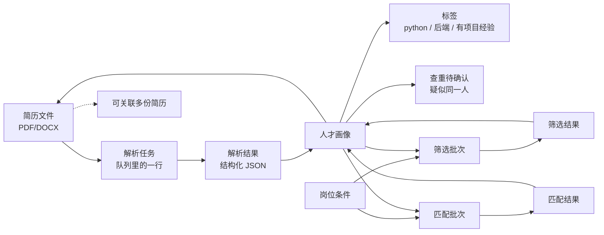

# AI 数字化人才平台 · 业务逻辑说明

> 版本：v1.0　|　日期：2026-11-03　|　用途：帮助业务/产品/开发快速理解本平台能做什么、怎么做、规则是什么、边界在哪里
> 配套技术文档：`main/docs/` 下的架构设计 / 数据库设计 / 接口设计 / 算法与判定规则 / 开发计划——本文不重复技术细节，只讲"业务是什么"

---

## 1. 平台定位

### 是什么
一个用 AI 帮 HR 处理人才简历的小而专的工具。**一期只做三件事**：

| 编号 | 能力 | 一句话说明 |
|---|---|---|
| F1 | **简历智能筛选** | HR 上传一批简历 → AI 自动解析每一份 → 按岗位要求打分 → 输出"通过 / 待定 / 淘汰"三档名单 |
| F2 | **人才画像档案** | 每份简历自动生成结构化的人才档案（姓名、学历、年限、技能、经历、标签、能力评分），支持人工修正、查重合并、语义检索 |
| F3 | **岗位-人才匹配** | 给定一个岗位，从人才库里找最匹配的候选人并排名（匹配和筛选共用评分引擎，但匹配多了向量相似度维度） |

### 不做什么（Out of Scope）
OCR 图片简历、多租户 RBAC 权限系统、消息队列/微服务、Docker 应用一键部署、完整的操作审计表、RAG 知识库对话、评分缓存（成本足够低时再补）、Alembic 数据库迁移工具、简历投递/录用/入职后续流程。

### 典型用户
HR 招聘专员：每天面对几十到上百份简历，需要快速筛出有价值的候选人、整理成画像档案、给用人部门提供匹配推荐。

---

## 2. 业务对象地图

先把平台里所有出现的"东西"用业务语言列一遍，后面的功能流程都围绕这些对象展开。



| 业务对象 | 是什么 | 关键属性（业务视角） |
|---|---|---|
| **简历文件** | HR 上传的 PDF/DOCX，存在服务器磁盘上 | 文件名、上传时间、上传批次号、SHA-256 指纹（同内容视为同一文件） |
| **解析任务** | 解析队列里的一条记录，代表"这份简历正在被 AI 处理" | 状态（排队/运行中/成功/失败/等 HR 查重/已取消）、当前处理到哪一步（提取 / 画像 / 向量） |
| **解析结果** | AI 从简历里提取的结构化 JSON | 姓名、学历、工作年限、技能列表、经历列表、项目列表、证书 |
| **人才画像** | 一份完整的人才档案，一期平台的核心实体 | 基本信息 + 归一化学历 + 标签（10-30 个自动打、可手动补充）+ 五维能力评分 + 关联的所有简历文件 |
| **标签** | 给画像打的"短词标签"，同时也是归一化后的技能 | 来源是 LLM 自动打或人工手动加；按类型分 4 类：skill（技能）/ industry（行业）/ level（级别）/ general（通用） |
| **查重待确认** | 系统怀疑两份简历其实是同一个人，挂起等 HR 决定 | 触发方式：手机号相同 / 邮箱相同 / 姓名+手机号相同 |
| **岗位条件** | HR 配置的"这个岗位要什么样的人" | 标题、职责描述、学历要求、年限要求、必备技能、加分技能、硬门槛开关、评分权重、通过/待定分数阈值 |
| **筛选批次** | 一次筛选动作的完整执行记录 | 用哪个岗位、选了哪些人、岗位配置的快照（岗位改了也不影响这一批）、执行状态、三档结果计数 |
| **筛选结果** | 筛选批次里某一个人的结果 | 通过/待定/淘汰、分数、硬淘汰标记、命中/缺失项、AI 理由、HR 人工改判 |
| **匹配批次** | 一次匹配动作的完整执行记录（和筛选批次结构同，但多向量相似度维度） | 同上 + 向量降级标记 |
| **匹配结果** | 匹配批次里某一个人的结果 | 名次、分数、硬淘汰置底原因、四维分 + 向量相似度、理由详情 |

### 重要关系
- **一份简历文件 → 一个解析任务（1:1 恒成立）**：不会一份简历建多个任务，任务取消了也不删行，靠 `requeue` 重新入队。
- **一个画像 ← 多份简历（N:1）**：同一人换简历换手机号重传，最终合并到一个画像。
- **一个解析结果 → 一个画像（1:1）**：解析结果最终归属到某个画像；查重"保留"场景是一个解析结果对应一个新建画像。
- **批次执行时快照固定**：创建批次那一刻选定的人才 ID 清单被"拍照"存下来，执行/重试都只按这张照片跑，不会重新去查新简历或删画像。

---

## 3. 功能一：简历上传与 AI 解析

### 完整业务流程（从 HR 点"上传"到画像出现在列表里）

```
HR 选择文件 → 系统校验（扩展名+文件头+大小 ≤20MB）→ 逐文件算 SHA-256 指纹
  ├─ 指纹已存在 → 不计入任务队列，提示"已有这份简历，可一键重新入队"
  └─ 指纹新 → 存磁盘（UUID 重命名，原始文件名保留）→ 建解析任务（状态=排队中）→ 上传完成，立即返回，不用等

后台 2 秒一次的"任务巡检员"发现有任务排队 → 认领 → 逐任务执行：
  Step 1 提取文本（pypdf/python-docx）→ 超长简历截断到 15000 字符
  Step 2 LLM 结构化提取 → 得到 JSON（姓名/学历/年限/技能/经历/项目/证书）
  Step 3 身份查重（三路：手机号 / 邮箱 / 姓名+手机号，规范化后比对）
    ├─ 命中既有画像 → 挂起"查重待确认"（不建画像）→ 等 HR 处理
    └─ 没命中 → Step 4 建画像

  Step 4 建画像（同事务）：
    - 把学历/年限/技能全部归一化后写入画像表
    - 调 LLM 打标签（10-30 个，同时判断技能）+ 评五维能力
    - 拼画像文本 → 算 SHA-256 → 送 Embedding → 写 Milvus 向量库
    - 全部成功 → 任务状态=成功，画像出现在列表里
    - 中间任何一步失败 → 任务状态=失败，显示在队列里可一键重试
```

### 关键业务细节

**上传阶段**
- 同内容简历重复上传**不报错**，计入返回里的 `duplicates` 数组，每项带一个 `task_id` 和"可重新入队"按钮状态。HR 改个文件名重传，还是会被 SHA-256 识别为同一份。
- 上传返回的 `upload_batch_id`（26 位随机码）贯穿后续：筛选/匹配可以按"某次上传的所有简历"为范围。

**查重挂起**
- 系统发现"手机号相同"或"邮箱相同"或"姓名+手机号相同"时，**不自动合并**，而是生成一条"查重待确认"记录。
- 队列里该任务状态显示为"等 HR 处理"，巡检员不再碰它。
- HR 有两个选择：
  - **合并（merge）**：两份合并成一个画像。默认 master 是先创建的那个（不能换）。标签取并集，经历数组按 `公司+职位+开始时间` 去重（冲突时保留 `end` 更晚、`description` 更长的那条）。LLM 不重跑标签，只用已有标签。向量重算。同步 ≤2 秒完成。
  - **保留（keep）**：两份各自独立，各建一个画像。同步先创建空画像行拿到 ID，然后交后台继续补标签/能力/向量（所以上传时就能返回新画像 ID，后台慢的话队列里会显示进度）。

**解析失败重试**
- 失败了点"重试" → 不是从头跑，而是**从失败的那一步继续**（断点续跑）。比如标签成功了、能力评分失败，重试时只跑能力评分，不重跑标签。
- 向量失败 → 只补向量，不重跑任何 LLM 调用。
- 取消了的任务（状态=已取消）→ 要"重新入队"（requeue），从头跑。
- **三条幂等护栏**：查重时排除自己刚建的画像（不会把自己判成重复人）；画像创建和解析结果回填同一事务（不会留下孤儿画像）；查重记录唯一（重试不会新增重复挂起）。

---

## 4. 功能二：人才画像档案

### 画像能做什么

| 能力 | 业务说明 |
|---|---|
| **查看详情** | 基本信息卡 + 标签 + 五维能力雷达图 + 经历时间线 + 项目列表 + 证书 + 所有关联简历原文下载 + 筛选历史 + 匹配历史 |
| **人工修正** | 可以改任何字段；被改过的字段会被"保护"（后续自动解析不会覆盖） |
| **标签管理** | 自动打的标签可以手动删/加；手动加的标签不会被自动覆盖 |
| **语义检索（F2-5）** | 用自然语言搜人，比如"找一个做过跨境电商的 Python 后端工程师" → 调 Embedding → Milvus 向量相似度排序 → 返回 Top 20 |
| **查重确认** | 见功能一"查重挂起" |
| **软删除 / 恢复** | 画像不会物理删除，只是打上"已删除"标记；删除后向量也删；需要恢复时用"回收站"视角进入 → 一键恢复，向量自动重建 |
| **重建向量** | 画像被改过、向量状态还是旧的，可以手动触发一次向量重算 |

### 字段级人工保护（F2-6）
- HR 修改画像自有字段（姓名、手机、邮箱、城市、学历、年限、职位、技能、标签、五维评分）后，该字段自动进入"人工保护清单"。教育/工作/项目/证书属于解析结果的聚合展示，一期只读，不参与人工修改。
- 后续同一人又上传新简历触发重新解析时，保护清单里的字段**不会被自动覆盖**。比如 HR 手动修正了手机号，新简历里有不同的手机号也不会覆盖手动修正的那个。

### 语义检索（F2-5）
- 技术上是 Embedding + Milvus COSINE 相似度。
- 画像文本构成：`姓名｜当前职位｜期望职位｜城市｜学历｜年限｜技能｜标签｜工作经历摘要｜项目摘要｜教育经历`。任何一项改动都会让 hash 变化，触发向量重算——所以改城市/学历/职位后检索结果自动更新。
- 查询侧：相同查询文本有短期缓存，避免每次搜都重算 embedding。

---

## 5. 功能三：岗位条件配置

### 岗位长什么样

| 字段 | 业务说明 |
|---|---|
| 标题 / 部门 | 基本信息 |
| 职责描述 JD | 大段文本，给 LLM 当上下文 |
| 任职要求 | 大段文本 |
| 学历要求 | 六选一（博士/硕士/本科/大专/高中中专/其他） |
| 年限要求 | 最低年限（比如 3） |
| 必备技能 | 数组，归一化后存（比如 `["python", "fastapi", "mysql"]`） |
| 加分技能 | 数组，命中加分但不淘汰 |
| 硬门槛开关 | 学历/年限/必备技能三项**可以单独关闭**（比如只卡技能不卡学历） |
| 评分权重 | 四维（技能 40% + 经历 30% + 教育 15% + 其他 15%）**总和必须 100** |
| 通过分数阈值 | ≥75 算通过，60–75 待定，<60 淘汰 |
| 版本号 | 每次修改 +1，筛选/匹配批次创建时"拍快照"存下来 |

### 版本化机制
- 岗位修改后版本号 +1。
- 已经跑过的**老批次不受影响**——批次里存了创建那一刻的岗位配置快照，岗位后来改了也不影响这一批的结果。这就是为什么"快照"很重要：保证筛选/匹配结果稳定可复现。

---

## 6. 功能四：简历筛选（F1）

### 业务流程

```
HR 创建筛选批次：
  - 选一个岗位（停用状态的岗位不允许）
  - 选范围（四种之一）：
      ├─ all_unscreened：所有"这个岗位从来没筛过"的画像（不重复筛）
      ├─ upload_batch：某次上传批次里的所有简历（会自动解析成画像才能筛）
      ├─ resume_file_ids：HR 手动勾选具体哪几份简历
      └─ all：全部画像（复筛）
  - 系统同步圈定 → 算出具体的人才 ID 清单 → 拍照存下来（快照）
  - 返回 202，立即开始

后台执行（TaskRunner）：
  按快照清单逐人：
    1. 先过硬门槛（零 LLM，纯规则）：学历 / 年限 / 必备技能
       ├─ 不达标 → 硬淘汰（score=NULL），原因写清楚
       └─ 达标 → 进下一步
    2. LLM 四维评分：技能 / 经历 / 教育 / 其他，各 0-100
    3. 按岗位权重加权合成总分
    4. 归档：≥pass_threshold → 通过；待定区间 → 待定；<pending → 淘汰
    5. 写结果行（唯一键保证幂等，重试不会重复写）

  全部跑完 → 批次状态=完成 → 三档计数重算 → HR 在列表里看到
```

### 筛选的核心规则

**硬门槛判定（规则化，零 LLM，确定性 100%）**
- **学历**：按六档排序值比（博士5 / 硕士4 / 本科3 / 大专2 / 高中中专1 / 其他0），候选人排序值 ≥ 岗位要求排序值 → 达标。
- **年限**：`employments` 区间合并（重叠区间只算一次），实习段按 title 关键词过滤掉（含"实习"或"intern"），累计总月数 ÷ 12 保留 1 位小数。候选人年限 ≥ 岗位要求 → 达标。
- **必备技能**：岗位要求的每个技能必须**都命中**候选人才行（AND 逻辑）。命中判定见 §8。

**评分公式（LLM + 规则混合）**
```
总分 = 技能分 × 权重 + 经历分 × 权重 + 教育分 × 权重 + 其他分 × 权重

经历分的计算（筛选 F1 特有的关键决策）：
  经历分 = LLM 给的经历分   ← 筛选不含向量相似度！
```

**三档结论**
| 条件 | 结论 | score 存储 |
|---|---|---|
| 硬门槛不达标 | 淘汰（硬淘汰） | NULL |
| score ≥ pass_threshold | 通过 | 数值 |
| pending_threshold ≤ score < pass_threshold | 待定 | 数值 |
| score < pending_threshold | 淘汰（软淘汰） | 数值 |

### 筛选特有机制
- **筛选路径不调用向量/Embedding**（和匹配的关键差异）。所以 Milvus 挂了也完全不影响筛选，筛选分数和结论不变。
- **人工改判**：筛选完成后 HR 可以把某个人从"待定"改成"通过"或"淘汰"，改判记录谁改的、什么时候改的。改判后计数同步更新。
- **重试**：失败批次重试只补缺（不重跑已写成员），想让画像修改生效请**另建批次**。

---

## 7. 功能五：岗位-人才匹配（F3）

### 和筛选的差异

| 维度 | 筛选 F1 | 匹配 F3 |
|---|---|---|
| 范围 | 四种 scope + 必须有 `job_profile_id` | 三种 scope（all / filter / upload_batch）+ 选岗位 |
| 评分公式 | 四维加权（经历分=LLM 经历分） | 四维加权（**经历分=0.7×LLM 经历分 + 0.3×向量相似度×100**） |
| 硬淘汰后 | score=NULL，归档到淘汰档 | score=0，标 `hard_fail`，**排名置底但仍在名单里**（"应用并标记"） |
| 向量不可用 | **无影响**（筛选不碰向量） | 按规则降级：经历分退化成纯 LLM，向量相似度=null，批次标 `vector_degraded=true`，照常执行不失败 |
| 结果呈现 | 三档 Tab（通过/待定/淘汰） | 排名列表（名次/分数/硬淘汰置底/理由详情抽屉） |

### 匹配特有的硬门槛"应用并标记"
硬淘汰**不排除出结果**，而是：score 置 0、`hard_fail=true`、排名排在所有未硬淘汰的后面。业务含义：这个人确实不满足硬条件，但 HR 能看到他、了解他哪条没过、如果想破格可以人工调整。

### 向量相似度怎么嵌入
- 岗位侧：JD + 任职要求 + 必备技能 + 加分技能 → 拼一段文本 → Embedding → 向量。**岗位向量在批次内只算一次**，所有候选人共享。
- 候选人侧：画像文本（和语义检索用的是同一份）已经在 Milvus 里，直接取。
- 相似度 = 岗位向量 和 候选人向量 的 COSINE 值，0–1。
- 进入经历分：`0.7×LLM经历分 + 0.3×相似度×100`。

### 降级场景（Milvus 或 Embedding 任一不可用）
- 批次照常执行不失败。
- 经历分退化为纯 LLM 分（`experience = llm_experience`，和筛选一样）。
- `vector_similarity` 列显示为 null。
- 批次详情页会有黄色告警条："本批次向量依赖不可用，经历维度仅按 LLM 评分，不宜与正常批次直接比较"。

---

## 8. 核心业务规则汇总

### 8.1 技能硬门槛命中判定（§3.3 算法与判定规则）

命中判定**对候选人 `skills_json` 数组的每个元素独立跑**（不把数组 join 成串），每个元素按下列规则短路判定：

| 规则 | 说明 | 举例 |
|---|---|---|
| a. 精确相等 | 归一化 + 别名映射后，和岗位技能规范名完全一样 | 岗位 `python` × 候选人 `python` ✓ |
| b. 词边界正则 | 岗位规范名作为独立词出现，不是子串 | 岗位 `java` × 候选人 `javascript` ✗（不是独立词）；岗位 `spring boot` × 候选人 `spring-boot` ✓（`spring[\s-]?boot`） |
| c. 剥离版本号后精确比 | 候选人技能先剥掉 `2.x` / `5+` / `(3年)` / `/框架` 等后缀再比 | 岗位 `python` × 候选人 `Python 3.11` ✓（剥离后 = python） |

**必须判不命中的反例**（单测强制）：
- 岗位 `java` × 候选人 `javascript`
- 岗位 `c` × 候选人 `c++`
- 岗位 `go` × 候选人 `google`
- 岗位 `react` × 候选人 `react-native`
- 岗位 `sql` × 候选人 `nosql`

**必须判命中的正例**（单测强制）：
- 岗位 `go` × 候选人 `golang`（别名表）
- 岗位 `spring boot` × 候选人 `springboot` / `spring-boot`
- 岗位 `javascript` × 候选人 `js`（别名表）
- 岗位 `python` × 候选人 `Python 3.11`（走 c 规则）

> 如果 join 成串后再跑正则，`javascript,java` 里逗号会被当成非词字符，`\bjava\b` 就会误命中——所以必须逐元素。

### 8.2 学历比较

**归一化值就是入库字面值**（六选一，精确字符串匹配）：

| 归一化值 | 排序值 | 可接受原文示例 |
|---|---|---|
| 博士 | 5 | 博士 / 博士研究生 / PhD / Doctor |
| 硕士 | 4 | 硕士 / 研究生 / MBA / Master |
| 本科 | 3 | 本科 / 大学本科 / 学士 / Bachelor |
| 大专 | 2 | 大专 / 专科 / 高职 |
| 高中中专 | 1 | 高中 / 中专 / 职高 / 技校 |
| 其他 | 0 | 无法识别 / 缺失 |

**比较规则**：候选人排序值 ≥ 岗位要求排序值 → 达标。**严禁**用字符串直接比较（字典序下"其他"会排在"大专"前面）。

### 8.3 工作年限计算

1. 把所有 `employments[]` 的起止时间解析出来（进行中按今天算）。
2. **合并重叠区间**：比如"2019-2021 A 公司"和"2020-2022 B 公司"重叠了一年，合并成 2019–2022 = 3 年。
3. **实习段不计入**：title 归一化后含"实习"或"intern"的段落跳过。
4. 累计总月数 ÷ 12，保留 1 位小数。
5. 完全缺失 → 判"工作年限缺失"，允许人工改判。

### 8.4 评分公式

```
总分 = skills分 × w_skills
    + experience分 × w_experience
    + education分 × w_education
    + others分 × w_others

权重总和必须 = 100（40/30/15/15 是默认值）。

experience 分项：
  筛选 F1：experience = llm_experience
  匹配 F3：experience = 0.7 × llm_experience + 0.3 × (vector_similarity × 100)

硬淘汰者不调 LLM 评分，直接在规则层算完。
```

### 8.5 批次快照语义

**所有批次结果 = 创建那一刻的"体检报告"**。执行/重试只按快照里的人才清单跑，不会重新圈人。

- 批次创建时还在解析的简历 → **不会**被补进这一批（快照里没有）。
- retry 前新增的画像 → **不会**被补进旧批次。
- retry 前画像被人工修改 → 已写的那条结果分数**不会变**。想让修改生效请**另建批次**。

---

## 9. 异常与边界场景

### 9.1 解析任务故障

| 场景 | 自动处置 | 人工入口 |
|---|---|---|
| LLM 提取失败 | 落 `failed(stage=extract)` | 队列里"重试"（断点续跑，从头跑） |
| 标签成功、能力评分失败 | 落 `failed(stage=profile)` | 队列里"重试"（断点续跑，只补能力，不重跑标签） |
| 向量失败（标签+能力都成功后） | 落 `failed(stage=vector)` | 队列里"重试"（断点续跑，只补向量，不重跑任何 LLM） |
| 进程崩溃重启 | 启动时把所有 running 重置回 pending 并保留 stage | 自动断点续跑，不用人工 |
| 查重挂起（duplicate_pending） | 巡检员不再碰 | 等 HR 点"合并"或"保留" |
| 误删了任务（置 cancelled） | — | 点"重新入队"，从头跑，不新插行 |

### 9.2 Milvus / Embedding 依赖故障

| 功能 | Milvus 不可用 | Embedding 不可用（Milvus 正常） |
|---|---|---|
| 语义检索 `GET /talents/search` | **503** | **503** |
| 筛选批次 F1 | **完全不受影响**（筛选不含向量） | **完全不受影响** |
| 匹配批次 F3 | 降级：经历分=纯 LLM，相似度=null，批次标 `vector_degraded=1`，照常执行不失败 | 同左 |
| 解析流水线 | 落 `failed(stage=vector)` | 同左 |
| PATCH 画像 / merge / restore（同步写路径） | **200** + `vector_status:"failed"`（不回滚业务数据） | 同左 |
| revector（只补向量，无业务写入） | **503** | 同左 |
| /health 探活 | `status: degraded`（HTTP 仍 200），`milvus:false` | `embedding_alive:false` |

### 9.3 删除后如何回头

| 误操作 | 补救 |
|---|---|
| 删了解析任务（置 cancelled） | `POST /resumes/queue/{id}/requeue` 从头重跑 |
| 软删了画像 | `GET /talents?deleted=true`（回收站视角）→ `POST /talents/{id}/restore` 恢复 |
| PATCH/merge 成功但向量没同步 | `POST /talents/{id}/revector` 手动重算，或 `python scripts/rebuild_vectors.py` 全量重建 |
| 批次失败 | `POST /{screen|match}/batches/{id}/retry` 复用原批次，只补缺失 |
| 误改了画像后想撤回 | 软删 → restore，或人工 PATCH 回滚 |

### 9.4 系统级约束

| 约束 | 原因 |
|---|---|
| **一期单 uvicorn 进程** | TaskRunner 靠 DB 状态表做任务锁，多进程会重复扫描 |
| **同步接口禁调 LLM** | LLM 延迟几十到上百秒，HTTP 接口会超时；Embedding 是唯一例外（单次 ≤1.5s，超时降级） |
| **MySQL 事务已提交后向量失败不回滚、不返回 503** | 业务数据已经落库，回滚反而让 HR 困惑；503 会让前端误判整次操作失败 |
| **一份简历文件永不物理删除** | 审计 + 原文下载需要；重新入队靠 requeue 不靠重新上传 |

---

## 10. 典型场景走查

### 场景 A：HR 上传一批简历 → 自动筛出合格候选人

```
1. HR 进入"简历筛选"页 → 拖拽上传 20 份 PDF/DOCX
2. 系统立即返回 upload_batch_id（比如 01J...）+ 上传汇总
   - 18 份 accepted 开始排队解析
   - 2 份 duplicates（之前传过），每项带"重新入队"按钮
3. 前端每 2 秒轮询队列进度：
   - 全部排队中 → 运行中 → 陆续成功
   - 其中 1 份挂起（手机号和已有画像重复 → 查重待确认）
4. HR 进"查重待确认"弹窗 → 决定合并或保留
5. 解析全部完成后，进"简历筛选"页下半部：
   - 选岗位"高级后端工程师"
   - 范围选 upload_batch → 填刚才的 01J...
6. 系统同步圈定 → 返回 202 + 快照总人数
7. 异步执行：过硬门槛 → LLM 四维评分 → 归档三档
8. 完成后前端自动刷新 → HR 看到：
   - 通过 6 / 待定 3 / 淘汰 9 / 硬淘汰 2（学历不达标）
   - 点某个人 → 看到命中哪些技能、缺什么、AI 理由
   - 把某个人从"待定"手动改成"通过"
   - 筛选列表里导出名单给用人部门
```

### 场景 B：用人部门想要"最匹配"的候选人排名

```
1. HR 进"岗位条件"页 → 选中"高级后端工程师"（version=3）
2. 进"岗位匹配"页 → 选岗位 → 范围选 all（全量画像）
3. 返回 202 + 快照人数
4. 异步执行：硬门槛 → 岗位向量 → 每人向量相似度 → LLM 四维 → 经历分合成
5. 完成后：
   - 排名列表按 hard_fail ASC, score DESC 稳定排序
   - 硬淘汰者 score=0、红色"不满足硬性条件"标签、置底
   - 点第 1 名 → 看到四维分 + 向量相似度 + 命中/缺失 + 完整理由
6. 假设 Milvus 刚好没启动：
   - 批次照常完成，不失败
   - 页头黄色告警条："本批次向量依赖不可用..."
   - 所有经历分 = 纯 LLM 分，相似度列显示 null
   - HR 知道这次结果"不是最优但可用"，下次启 Milvus 后另建批次重跑
```

### 场景 C：系统故障后恢复

```
场景：解析任务跑到一半（LLM 标签成功、Embedding 还没调）时进程崩了。

1. 重启 uvicorn → lifespan 启动 TaskRunner
2. TaskRunner 启动时发现：
   - 原来的任务 status='running'（崩溃前没来得及写 running 吗？不——
     认领时就写 running，所以崩溃后 heartbeat_at 过期，启动时无条件重置）
   - 启动把所有 running 重置回 pending，保留 stage
   - 该任务 stage='profile'、talent_profile_id 已回填、tags_json 已有
3. 巡检员发现 pending → 认领 → 读 stage='profile' + tags_json 非空
4. 跳过标签 → 补能力评分 → 跳过 embedding？不，向量阶段没成功 → 继续向量
   （等等，这里 stage 还是 profile，还没走到 vector，所以会继续：
   能力评分 → 向量 embedding+upsert → success + profiled_at/finished_at）
5. 整个过程**不重跑标签**，幂等正确。HR 不需要做任何事，队列里任务自动跑完。
```

---

## 11. 决策编号索引（业务视角不关心，保留备查）

| 决策 | 业务影响 |
|---|---|
| D-A 筛选不含向量相似度 | 筛选分数与 Milvus 无关；匹配才用向量 |
| D-B 同步接口允许单次 Embedding/Milvus | PATCH 画像、merge 可以同步完成（≤2s），受 1.5s 超时预算约束 |
| D-C 并发配置持久化 | 并发数可运行时改、重启保持 |
| D-D 批次成员快照 | 批次创建那一刻"照片"，执行/重试不重新圈人 |
| D-E retry 复用原批次 | retry 不改快照，只补缺 |
| D-F 实习按 title 关键词过滤 | 不依赖 LLM 输出，规则层自己能判定 |
| D-G（本轮新增）技能逐元素 + profile 子步骤跳过 | 防子串穿透 + keep/retry 省 LLM 调用 |
| D-H 软取消 + requeue/restore/revector | 删除/取消后都能回头，不留死角 |
| D-I 解析断点续跑 | 重试只补失败步骤，不自判重，不重复建画像 |

---

## 附：和技术文档的快速映射

| 业务问题 | 去哪份技术文档找答案 |
|---|---|
| 这个功能有什么接口、入参出参是什么 | `接口设计.md` |
| 数据存在哪张表、字段叫什么 | `数据库设计.md` |
| 硬门槛怎么判定、评分公式是什么 | `算法与判定规则.md` |
| 系统整体怎么搭起来的（分层、目录、依赖） | `架构设计.md` |
| 先做什么、依赖什么、每个任务怎么验收 | `开发计划-todolist.md` |
| 最原始的业务需求和验收标准 | `需求文档.md` |
