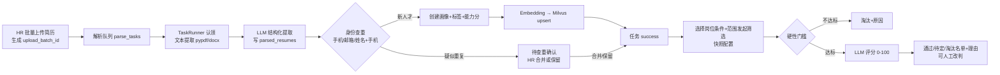
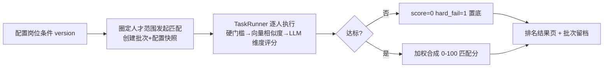

# 需求文档 · AI 数字化人才平台（精简版）

> 版本：v1.5　|　日期：2026-11-05　|　状态：已确认
> 变更记录：v1.1 一期/二期部署划分；v1.2 向量库改为本机 Milvus、新增 Embedding/UI 选型；v1.3 按《架构评审与修改建议》回写——F1-6 筛选范围定义、F1-10 改判审计、F2-2 改身份查重、F2-6 字段级保护、F3 硬门槛呈现口径、常驻 TaskRunner、单进程部署约束、评测集重建（AI 合成样本）、决策记录 #15–#24。
> **v1.4 跨文档一致性修订**（决策记录 #25–#34，详见 §12；字母与《架构设计》v1.3/《数据库设计》v1.2/《接口设计》v1.3/《算法与判定规则》v1.1 中的 D-A~D-J 一一对应；D-K 为开发批次排序决策，仅登记在《开发日志》Layer 5 与 todolist v1.4（当时版本，现已 v1.5））：
> **v1.5 变更**（决策记录 #35，详见 §12）：**#35 D-L**——LLM 与 Embedding **允许不同供应商**（实际：LLM=讯飞 spark-x2.6、Embedding=阿里百炼 text-embedding-v3，均 OpenAI 兼容），§2 #13"与 LLM 同供应商"约束作废；《算法与判定规则》§2.6 实习判定英文关键词改词边界（算法 v1.2，审核 A3）。
> - **#25 D-A**：向量相似度**只进匹配（F3）**，筛选（F1）`experience = LLM 经历分`、不调用 Embedding/Milvus；必备技能命中**禁止裸子串包含**（`java` 不得命中 `javascript`）——修正原 F1-8/F3-8 与验收 12 的口径冲突及硬门槛穿透。
> - **#26 D-B**：向量同步失败**不回滚业务写入**，接口返回 200 + `vector_status:"failed"`，提供补偿手段（`revector` / `rebuild_vectors.py`）——修正"503 一律不可写"与 merge ≤2s 的冲突。
> - **#27 D-C**：任务并发数为 **TaskRunner 全局**配置，持久化到新增 `sys_settings` 表（一期共 **13 张业务表**），改动下一个扫描周期生效。
> - **#28 D-D**：批次成员在创建时以 `resolved_ids` **快照**锁定，worker/重试不重新圈人。
> - **#29 D-E**：批次 retry 统一为**复用原批次**语义，`retry_of_batch_id` 改为 `retry_count`，并明确复位/保持不变的字段清单。
> - **#30 D-F**：实习经历**只按 `employments[].title` 关键词识别**（`实习`/`intern`），不依赖 LLM 输出 `is_internship`（ResumeSchema 无此字段）。
> - **#31 D-G**：学历枚举字面值统一为 `博士/硕士/本科/大专/高中中专/其他`（原"高中/中专"作废）。
> - **#32 D-H**：生命周期补齐——解析任务新增 `cancelled` 状态与 `requeue`；画像新增 `restore`（撤销软删除）；`duplicate_pending` 只能经 `resolve`（merge/keep）转出。
> - **#33 D-I**：解析重试为**断点续跑**（保留 `stage`）并加三重幂等防护（查重自排除、建画像与回填同事务、`talent_duplicates.parsed_resume_id` 唯一）。
>
> 本文档基于《PRD-2026-AI数字化人才平台》及 design/test 配套文档裁剪而成，**仅覆盖三个功能**：简历智能筛选、人才画像档案、岗位-人才匹配。
> 本文档是后续架构设计、数据库设计、接口设计、开发计划、测试验收的唯一需求依据。

---

## 1. 项目概述

### 1.1 项目定位
全新开发（不基于旧 ai_talent 仓库）的企业级 AI 人才管理工具，以大模型完成简历结构化解析、人才画像构建、岗位-人才智能匹配，帮助 HR 从手工筛简历中解放出来。

### 1.2 功能范围（只做这三个）
| 编号 | 功能 | 一句话描述 |
|---|---|---|
| F1 | 简历智能筛选 | 批量上传简历 → AI 解析 → 按岗位条件自动打分筛选，输出通过/待定/淘汰名单及理由 |
| F2 | 人才画像档案 | 每位候选人一份结构化画像（标签、能力维度、经历时间线），支持筛选与语义检索 |
| F3 | 岗位-人才匹配 | 配置岗位条件 → 对人才库批量匹配 → 0–100 匹配分排名 + 可解释理由 |

**明确不做**（Out of Scope，一期）：智能测评、培训课程、RAG 知识库问答、自然语言问数、Agent 编排、多智能体、JD 投放、面试管理、移动端、国产化适配、OCR/扫描件解析、多角色 RBAC（仅预留 role 字段）、Docker 应用封装（二期）、Alembic 迁移体系、完整审计日志表、消息队列/微服务。

### 1.3 用户角色
| 角色 | 说明 |
|---|---|
| HR / 招聘 | 本期唯一业务角色，登录后可使用全部 3 个功能 |
| 系统预留 | 用户表含 `role` 字段，后续可扩展 RBAC（业务负责人/管理员），本期不实现权限差异 |

---

## 2. 技术约束（已确认）

| 项 | 决策 |
|---|---|
| 开发方式 | 空目录全新开发，旧文档仅作需求参考 |
| 后端 | Python 3.11+ 与 FastAPI；**同步 SQLAlchemy 2.x + 同步 def 路由**（FastAPI 线程池执行；仅上传/下载用 async）；ORM 全映射，**禁止裸 SQL** |
| 数据库 | MySQL 8.x（本机 localhost:3306，已运行），一期共 **13 张业务表**（含运行时配置表 `sys_settings`） |
| 前端 | Next.js 14（App Router）+ React + TypeScript + **Ant Design 5 + @ant-design/charts**，前后端分离 |
| 向量检索 | **Milvus Standalone（本项目独立 docker-compose，独立容器名与数据卷）**，`MILVUS_URI=http://localhost:19530`；pymilvus 3.0.2 兼容性开发前实跑验证；**严禁复用或触碰其他项目的 Milvus 实例与数据**；不引入 Neo4j/Redis/MinIO（应用层）/Celery |
| LLM 接入 | OpenAI 兼容 API，后端统一封装 LLM 客户端，`LLM_BASE_URL` / `LLM_API_KEY` / `LLM_MODEL` 环境变量配置；`temperature=0`；**真实调用，禁用 mock 数据充当业务结果** |
| Embedding | 云端 API，`EMBEDDING_*` 环境变量配置；**允许与 LLM 不同供应商**（决策 #35 D-L：实际 LLM=讯飞、Embedding=百炼） |
| 简历格式 | PDF（文本层）+ Word（docx），使用 pypdf / python-docx 提取文本；不做 OCR |
| 认证 | JWT 登录（HS256，24h），单一 HR 角色 |
| 后台任务 | **进程内常驻单例 TaskRunner**（lifespan 启动，扫描 parse_tasks/screen_batches/match_batches，**三类任务共用一个线程池**，并发数存 `sys_settings.task_concurrency`，默认 2、范围 1–5，乐观锁认领，心跳+重启恢复，优雅停止等待 `TASK_SHUTDOWN_TIMEOUT`）；不引入 Celery |
| 向量同步失败 | Milvus/Embedding 不可用时**不回滚已提交的业务写入**：解析任务落 `failed(stage=vector)` 可重试；同步接口返回 200 + `vector_status:"failed"`，由 `POST /talents/{id}/revector` 或 `scripts/rebuild_vectors.py` 补偿（向量属派生数据） |
| 部署约束 | 一期仅允许**单 uvicorn 进程**（`--workers 1`）；支持局域网访问（监听 0.0.0.0） |

---

## 3. 功能需求

### 3.1 F0 公共基础：登录与用户

| 编号 | 需求 | 说明 |
|---|---|---|
| F0-1 | 用户登录 | 账号密码登录，签发 JWT；未登录访问业务接口返回 401；账号停用返回 403 |
| F0-2 | 种子账号 | 系统初始化时内置一个 HR 账号（`hr / hr123456`），首版不做注册页 |
| F0-3 | 角色字段 | `users` 表含 `role` 字段（本期固定 `hr`），仅预留 |

### 3.2 F1 简历智能筛选

#### 3.2.1 简历上传与解析
| 编号 | 需求 | 说明 |
|---|---|---|
| F1-1 | 批量上传 | 支持一次上传多份 PDF/DOCX（单文件 ≤20MB），入解析队列；按文件内容 SHA-256 去重，重复文件**提示并跳过（HTTP 202 + duplicates 列表，不报错）**；每次上传生成 `upload_batch_id`（ULID）标识本批次。**原始文件永不物理删除**（删任务/删画像都保留），因此同一份内容再次上传必定落入 duplicates；duplicates 项返回 `resume_file_id`/`task_id`/`task_status`/`can_requeue`，被取消或失败的任务可直接重新入队 |
| F1-2 | 解析队列 | 队列状态可见：待解析/解析中/成功/失败/待查重确认/**已取消**；**任务并发数可配置（默认 2，范围 1–5）**——该值为 TaskRunner **全局**并发（解析/筛选/匹配共用），持久化在 `sys_settings`，修改后**下一个扫描周期生效**、无需重启；失败可重试（记录失败阶段 stage，重试**断点续跑**：保留 stage 从失败阶段继续，不重跑已完成阶段）；支持删除单条任务（**软取消**：置 `cancelled`，文件与已产出数据保留；running 中拒绝删除）与**重新入队**（`requeue`：`cancelled`/`failed` → `pending`，stage 清空、全流程重跑）；服务重启后任务自动恢复 |
| F1-3 | AI 结构化提取 | 每份简历经 LLM 提取为结构化 JSON：基本信息（姓名/性别/出生年/电话/邮箱/城市）、教育经历（学校/专业/学历/起止时间）、工作经历（公司/职位/起止时间/职责描述）、技能列表、项目经历、证书、期望岗位、总工作年限（按经历区间合并计算，规则见《算法与判定规则》）；**学历输出归一化枚举字面值**（`博士/硕士/本科/大专/高中中专/其他`）；实习经历按职位名称关键词识别并从年限中剔除（决策 #30） |
| F1-4 | 解析结果落库 | 提取结果写入 `parsed_resumes`（与 `resume_files` 1:1，**重复执行按 `resume_file_id` upsert，不产生第二行**）；随后完成查重判定与画像生成（含标签、能力评分、向量入库），**全部成功任务才标记 success**；原始文本留存备查 |
| F1-5 | 解析失败处理 | LLM 输出不合 JSON 规范时自动修复/重试 1 次，仍失败则标记任务失败并记录**失败阶段（extract/profile/vector）与原因**，不影响队列其他任务，可重试。**幂等要求（决策 #33）**：重试不得产生重复画像——查重必须排除"本解析结果已指向的画像"，画像创建与 `parsed_resumes.talent_profile_id` 回填在**同一事务**内完成；`duplicate_pending` 状态只能由 HR 的 merge/keep 操作转出，runner 不扫描 |

#### 3.2.2 筛选评分
| 编号 | 需求 | 说明 |
|---|---|---|
| F1-6 | 选择岗位条件发起筛选 | 针对某个已配置的岗位条件（见 F3-1），对指定范围的简历发起筛选。**范围四种**：`all_unscreened`（该岗位从未筛过的人才）/ `upload_batch`（某次上传批次）/ `resume_file_ids`（显式指定）/ `all`（全部已画像人才，用于复筛）。批次启动时**快照岗位条件配置**，后续修改岗位不影响本批次；同时**快照成员名单 `resolved_ids`（决策 #28）**——圈定只发生在创建批次那一刻，worker 与重试都只读快照、不重新圈人（期间新上传/新删除的人才不影响本批次）；执行时成员已被软删除的跳过并计入 `skipped_deleted`，`total` 保持快照值 |
| F1-7 | 硬性条件淘汰 | 岗位条件中可逐项开关的硬性门槛，任一不达标直接淘汰并记录淘汰原因：最低学历、最低工作年限、必备技能关键词（缺失任一即淘汰）。学历/年限/技能判定按《算法与判定规则》归一化后比较；**技能命中判定禁止裸子串包含**（岗位 `java` 不得命中候选人 `javascript`、`c` 不得命中 `c++`），必须用词边界/别名规范名匹配（《算法与判定规则》§3.3） |
| F1-8 | AI 综合评分 | 通过硬性门槛的简历由 LLM 按岗位条件打 0–100 分（temperature=0），并生成评分理由（命中项/缺失项摘要）；公式见《算法与判定规则》§4。**筛选不使用向量相似度（决策 #25）**：`experience` 直接取 LLM 经历分，全流程不调用 Embedding/Milvus，因此向量库故障对筛选零影响；硬淘汰者不调用 LLM |
| F1-9 | 三档结论 | **≥pass_threshold（默认 75）通过；pending_threshold（默认 60）~pass_threshold 待定（人工复核）；<pending_threshold 淘汰**。阈值存于岗位条件配置，可按岗位覆盖默认值 |
| F1-10 | 名单输出 | 筛选结果页：通过/待定/淘汰三个名单，分页展示，含姓名、分数、结论、理由摘要；支持关键词过滤；支持人工改判（通过↔待定↔淘汰，**记录改判操作人与时间**，可撤销） |
| F1-11 | 汇总统计 | 显示本次筛选总数、各档人数、通过率（口径：passed / total，total 含硬淘汰）；批次完成后按结果表重算，避免计数漂移 |
| F1-12 | 批次重试与幂等 | failed 批次可重试；**复用原批次**（重置 status/error/started_at/heartbeat_at/finished_at，`retry_count+1`，`progress` 按已有结果行数重算；`config_snapshot_json`/`job_profile_version`/`resolved_ids`/`total` 保持不变）；同一批次内 `(batch_id, talent_profile_id)` 唯一，重试只补算缺失项，不产生重复结果、结果行数不变 |

### 3.3 F2 人才画像档案

| 编号 | 需求 | 说明 |
|---|---|---|
| F2-1 | 自动生成画像 | 简历解析成功后自动创建人才画像：结构化信息 + LLM 生成的标签集（技能/行业/职级等类型，10–30 个，归一化后同步写入 `talent_tags` 关联表）+ 能力维度评分（专业技能/项目经验/教育背景/稳定性/成长潜力，各 0–100，附一句话依据） |
| F2-2 | 身份查重 | 新解析结果按**规范化后的手机号 / 邮箱 / 姓名+手机号**三路判重（姓名单独相同不判重，避免同名误合并；文件内容重复已在上传阶段拦截）。疑似重复时写入待确认记录、解析任务置"待查重确认"，**不创建画像**；HR 确认后二选一：**合并（merge，同步 ≤2s）**——主画像固定为 `profile_a_id`（既有画像，HR 不可另选）、字段合并"人工保护优先 → 较新简历非空值"、`ability_scores` 沿用主画像不重算、标签/技能取并集（同事务重建 `talent_tags`）、该解析结果改指主画像、画像文本重算并按 hash 变化重算向量、查重记录置 `merged`、解析任务置 `success`（**此阶段无第二个画像存在，故不涉及"被合并画像软删除"**；仅当 HR 先 keep 建出画像、事后又要合并时才产生软删除）；**保留（keep，202 异步）**——同步阶段先建独立画像行并回填 `parsed_resume`/`profile_b_id`、解析任务转 `pending(stage=profile)`，LLM 标签/能力/向量由后台补齐 |
| F2-3 | 画像列表 | 分页列表：姓名、当前/最近职位、年限、学历、标签（前若干个）、来源简历、更新时间；支持关键词搜索 + **标签精确过滤（走 talent_tags 表）** + 学历/年限区间过滤；已软删除画像不出现（**「回收站」开关可切换为只看已删除画像，用于恢复**） |
| F2-4 | 画像详情 | 基本信息、标签全集、能力维度（雷达图展示）、教育/工作/项目经历时间线、证书、原始简历文件下载（前端 blob 方式带鉴权）、历次筛选与匹配记录；**`vector_status` 为 `failed` 时展示告警条与"重建向量"入口** |
| F2-5 | 语义检索 | 输入自然语言（如"做过跨境电商的后端，会 Go"），基于画像文本向量做语义检索，返回相关度排序的画像列表；向量存本项目独立 Milvus，画像更新时同步更新向量；相同查询文本短期缓存 embedding；**Milvus/Embedding 不可用时该接口返回 503**（仅此接口 503，见 §7） |
| F2-6 | 画像编辑 | HR 可人工修正画像字段与标签；**字段级保护**：仅本次修改的字段记入 `manual_edited_fields`，被保护字段不被后续自动解析覆盖，其余字段仍可自动更新；`degree` 等枚举字段做合法性校验（非法 400）。**向量重算以画像文本 hash 变化为准（决策 #26）**：任何写入路径（解析创建/PATCH 任意字段/merge/rebuild 脚本）都重算画像文本并比对 `profile_text_hash`，变化才重新 embedding + upsert，**不得只按"改了 tags/skills/经历"判断**（否则改 city/职位等会导致向量陈旧）；同步写入受 `VECTOR_SYNC_TIMEOUT`（5s，v1.4）约束，超时或失败返回 200 + `vector_status:"failed"` |
| F2-7 | 删除档案 | 删除画像为**软删除**（`deleted_at/deleted_by`），连带删除 Milvus 向量（向量删除失败不阻塞，残留向量无害——检索会回查 MySQL 并排除软删除画像）；历史筛选/匹配结果保留并可显示姓名；需二次确认；**支持撤销软删除（`restore`）**，恢复后按需重建向量；**已删除画像经列表页「回收站」视角（`GET /talents?deleted=true`）查看与恢复**，默认视角不可见 |

### 3.4 F3 岗位-人才匹配

| 编号 | 需求 | 说明 |
|---|---|---|
| F3-1 | 岗位条件配置 | 岗位条件 CRUD：岗位名称、部门、职责描述、任职要求、结构化条件（最低学历/最低年限/必备技能/加分技能）、硬性门槛开关、筛选阈值、**匹配权重**（默认：技能 40% + 工作经历相关性 30% + 教育背景 15% + 项目/证书等 15%，可配置，总和须为 100%）；**最低学历取值必须是归一化枚举字面值之一**（`博士/硕士/本科/大专/高中中专/其他`，决策 #31），技能归一化（小写/去修饰/别名映射）后存储；校验失败统一 400；**每次修改 version+1**（作为批次快照与缓存失效依据） |
| F3-2 | 发起批量匹配 | 选择一个岗位条件，对人才库（`all` / 条件过滤 `filter` / `upload_batch`）发起匹配，后台 TaskRunner 异步执行，进度可见，服务重启可恢复；同 F1-6，创建时**快照岗位配置与成员名单 `resolved_ids`** |
| F3-3 | 匹配评分 | 每个人才输出 0–100 匹配分 = 四维得分按权重加权（向量相似度嵌入"经历相关性"维度：experience = 0.7×LLM 经历分 + 0.3×相似度×100），公式与归一化规则见《算法与判定规则》；岗位侧向量在批次内只算一次复用。**Milvus 或 Embedding 不可用时降级不失败**：`experience = LLM 经历分`、`vector_similarity` 置 null、批次打 `vector_degraded=true` 并在前端告警，排名照常产出 |
| F3-4 | 可解释理由 | 每条匹配结果附：命中项列表、缺失项列表、一段总结性匹配理由 |
| F3-5 | 匹配硬门槛呈现 | 匹配同样应用硬性门槛，采用**"应用并标记"**：不达标者不排除，`score=0`、`hard_fail=1`、记录原因，**排名置底**，前端红色标记"不满足硬性条件"；批次汇总含硬淘汰人数；命中/缺失列表照常生成 |
| F3-6 | 匹配结果排名 | 结果页按匹配分降序分页展示（hard_fail 置底，同分按 talent_profile_id 升序保证稳定；名次查询时计算），显示姓名/分数/命中数/缺失数，点击查看理由详情；支持一键查看人才画像 |
| F3-7 | 匹配历史记录 | 每次批量匹配保存为一个"匹配批次"（含岗位配置快照与成员快照），可查看历史批次及其结果；failed 批次可重试（复用原批次、`retry_count+1`、幂等补缺，见 F1-12） |
| F3-8 | 与筛选共用引擎 | F1 的筛选是 F3 匹配在"新简历集合"上的特化应用，两者共用评分/理由生成逻辑（match_engine），避免重复实现；**唯一差异是向量维度（决策 #25）**：引擎带 `use_vector` 开关，筛选传 `False`（`experience` = LLM 经历分、不调 Embedding/Milvus）、匹配传 `True`；两者硬淘汰呈现口径不同（筛选淘汰且 `score=NULL`，匹配标记且 `score=0` 置底） |

---

## 4. 核心业务流程

### 4.1 简历入库 → 查重 → 画像 → 筛选 主流程

### 4.2 岗位-人才匹配流程

---

## 5. 数据实体（概念模型，详见《数据库设计》v1.2）

一期共 **13 张业务表**（新增运行时配置表 `sys_settings`；`llm_score_cache` 评分缓存表按决策 D-7 缓办，启用则 13→14 张，B5 联调视 LLM 成本再定）：

| 实体 | 关键字段（示意） | 说明 |
|---|---|---|
| users | id, username, password_hash, role, is_active | 登录用户 |
| **sys_settings** | id, **setting_key(唯一)**, setting_value, value_type, updated_by | 运行时配置（一期仅 `task_concurrency`，1–5，默认 2） |
| resume_files | id, filename, file_hash(唯一), stored_path, **upload_batch_id**, uploaded_by | 原始简历文件（**永不物理删除**） |
| parse_tasks | id, resume_file_id(唯一), status(**含 cancelled**), **stage**, error, retries, started_at, heartbeat_at, profiled_at | 解析队列任务（与 resume_files 1:1） |
| parsed_resumes | id, resume_file_id(**唯一**), talent_profile_id, structured_json, raw_text | 结构化解析结果（按 resume_file_id upsert） |
| talent_profiles | id, name, phone, email, degree, work_years, tags_json, ability_scores_json, **manual_edited_fields**, **deleted_at/deleted_by**, **vector_status**, profile_text_hash, updated_by | 人才画像（软删除可恢复+字段级保护） |
| talent_tags | id, talent_profile_id, tag, tag_type, source | 标签关联表（筛选/统计事实来源；tags_json 仅展示冗余；`(profile,tag)` 唯一） |
| talent_duplicates | id, profile_a_id, profile_b_id, **parsed_resume_id(唯一)**, reason(phone/email/name_phone), matched_value, status(pending/merged/kept), resolved_by/at | 查重待确认 |
| job_profiles | id, title, jd_text, requirements_text, 结构化条件, hard_rule_switches_json, 阈值, weights_json, **version**, is_active, created_by/updated_by | 岗位条件 |
| screen_batches | id, job_profile_id, **job_profile_version**, **config_snapshot_json**, **scope_json（含 resolved_ids 成员快照）**, status, progress, total, 三档计数, **vector_degraded**, **started_at/heartbeat_at/error/retry_count** | 筛选批次 |
| screen_results | id, batch_id, talent_profile_id（**批次内唯一**）, hard_fail, score(硬淘汰 NULL), verdict, manual_verdict, **manual_verdict_by/at**, reason, hits/misses | 筛选结果 |
| match_batches | id, job_profile_id, **job_profile_version/config_snapshot_json**, **talent_scope_json（含 resolved_ids）**, status, progress, **hard_failed**, **vector_degraded**, error, **retry_count** | 匹配批次 |
| match_results | id, batch_id, talent_profile_id（**批次内唯一**）, score(硬淘汰=0), **hard_fail/hard_fail_reason**, dimension_scores_json(含 vector_similarity 可 null), hits/misses, reason | 匹配结果（名次查询时计算） |

向量数据：画像文本 embedding 存本项目独立 Milvus（collection `talent_vectors`），以 `talent_profile_id` 关联，不入 MySQL；向量为派生数据，可全量重建。

---

## 6. 页面清单（供前端设计与原型对照）

| 页面 | 对应功能 | 要点 |
|---|---|---|
| 登录页 | F0 | 账号密码 |
| 简历智能筛选 | F1 | 上传区（含批次标识、重复文件可"重新入队"）、解析队列状态（含失败阶段、**并发数设置**、重试/**重新入队**）、发起筛选（岗位+四种范围）、通过/待定/淘汰名单 Tab、汇总卡片、人工改判（留操作人）、失败批次 retry |
| 人才画像档案 | F2 | 列表（关键词/标签/学历/年限过滤 + 语义检索框）、详情页（雷达图+时间线+标签编辑+字段级保护提示+**向量状态告警与重建入口**）、**查重确认弹窗**、原文 blob 下载、删除二次确认、**已删除画像可恢复** |
| 岗位条件配置 | F3/F1 | 岗位条件 CRUD 表单（硬性门槛开关、阈值、权重总和校验、version 展示） |
| 岗位-人才匹配 | F3 | 发起匹配、进度轮询、批次历史、排名结果（**硬淘汰红色标记置底**）、理由详情抽屉 |

> 旧《产品原型图.md》《PRD》仅作背景参考，本期只实现上述 5 个页面，不按旧原型开发多余模块。

---

## 7. 接口约定（详见《接口设计》v1.3）

- 基址 `/api`，RESTful + JSON；FastAPI 自动 OpenAPI 文档。
- 统一返回：`{ "code": 0, "message": "success", "data": {...} }`；列表 data 为 `{items, total, page, page_size}`。
- 分页参数：`page`（默认 1）、`page_size`（默认 20，上限 200）。
- 鉴权：除登录与 health 外全部接口需 JWT（`Authorization: Bearer`）；文件下载由前端 axios blob 方式携带。
- 长任务：POST 发起返回 **HTTP 202** + batch_id，由常驻 TaskRunner 异步执行，前端轮询批次接口获取进度；批次接口提供 retry。
- 错误码：0 成功 / 400 参数或业务校验（权重总和、阈值大小关系、学历枚举等）/ 401 未认证 / **403 账号停用** / 404 不存在（含重复 DELETE、重复 resolve）/ 409 冲突 / 422 Pydantic 校验失败 / 500 内部错误 / **503 依赖不可用**。
- **503 与"半写"边界（决策 #26）**：503 只用于**尚未产生任何业务写入**的场景（语义检索、`revector`、创建批次前的依赖校验）；一旦 MySQL 已提交而向量同步失败，**不回滚、不报 503**，返回 200 + `vector_status:"failed"` + 提示"画像已保存，向量同步失败，可稍后重试"，由补偿接口/脚本修复；解析流水线内部向量失败则任务落 `failed(stage=vector)`。
- 时间统一 ISO 8601（Asia/Shanghai 约定）。

---

## 8. 非功能性需求

| 类别 | 指标 |
|---|---|
| 简历解析字段准确率 | ≥95%（关键字段加权：姓名/电话/学历/年限/技能；以重建评测集实测） |
| 筛选/匹配结论一致率 | 与标注一致率 ≥85%（以重建评测集为基准） |
| 接口响应 | 普通接口 ≤2s（10 并发 p95）；**LLM 调用只发生在 TaskRunner 后台任务**；同步接口内唯一允许的外部调用是 Embedding/Milvus（语义检索与向量同步），受 `VECTOR_SYNC_TIMEOUT`（5s，v1.4）约束——热连接 0.5–0.7s 下 merge/PATCH 仍 ≤2s，冷连接首次同步最多等 5s 后降级半写 |
| 向量语义检索 | ≤1s（千级画像规模；先实测，若因云端 Embedding 网络往返超标，口径调整为"Milvus 检索 ≤1s 不含 embedding 网络耗时"+相同查询短期缓存） |
| 并发 | 10 个并发用户正常操作；后台任务并发数可运行时调整（`sys_settings.task_concurrency`，1–5） |
| 任务可靠性 | 解析/筛选/匹配运行中重启服务，任务自动恢复（**启动时无条件把 running 置回 pending 并保留 stage**）或明确失败可重试；批次成员以 `resolved_ids` 快照锁定，重试只补缺失项、不重新圈人；解析重试断点续跑且不产生重复画像；优雅停止等待在跑任务（`TASK_SHUTDOWN_TIMEOUT` 默认 30s），超时则回置 pending |
| 依赖降级 | Milvus/Embedding 不可用时：语义检索 503、解析落 `failed(stage=vector)` 可重试、**筛选完全不受影响**、匹配降级执行（`vector_degraded`）、画像 CRUD 正常写入（向量待补偿）、`/health` 报 degraded |
| 安全 | 密码 bcrypt 哈希；JWT 过期 24h；上传文件校验扩展名+magic bytes、重命名存储；手机号/邮箱日志脱敏；提示词注入防护（简历文本只作数据处理，指令与数据分隔）；**简历含 PII，发送云端 LLM 需知晓合规责任** |
| 数据 | MySQL 备份脚本（Windows 可用的 Python 版）；上传文件保留原始副本；Milvus 向量可由画像文本全量重建 |
| 可用性 | 单机本地部署可完整跑通全部流程；一期单 uvicorn 进程 |
| 部署方式 | 一期：本机运行 + 局域网访问（监听 0.0.0.0）；Milvus 依赖本项目独立 docker-compose；**二期：应用 Docker 封装交付**，一期通过环境变量/配置分离预留 |

---

## 9. 验收标准

1. **功能闭环**：上传 10+ 份简历（PDF/DOCX 混合，AI 合成样本）→ 全部解析入画像 → 配置岗位条件 → 完成筛选出三档名单 → 发起匹配出排名与理由，全程无 mock 数据、无手工改库。
2. **硬性淘汰正确**：构造学历/年限/必备技能不达标简历各 1 份，筛选与匹配中均被正确判定且原因准确；匹配中 `hard_fail=1`、排名置底、前端红色标记。**技能判定反例必过**：岗位必备 `java` 时，技能只有 `javascript` 的候选人必须被淘汰（不得子串误命中）；`go` 与 `golang` 必须视为命中。
3. **查重**：同一人换手机号格式（`13800000000` 与 `+86 138 0000 0000`）**且简历内容有差异**（否则在上传阶段就被 SHA-256 拦为 duplicates）重传，触发查重待确认；合并后只剩一个画像、主画像为既有画像（`profile_a`）、向量已重算、该解析结果指向主画像、解析任务转为 success；选择"保留"则两份画像独立。
4. **语义检索**：3 条自然语言查询返回结果相关性符合直觉。
5. **可解释性**：随机抽 5 条筛选/匹配结果，命中/缺失项与简历内容一致。
6. **量化指标**：解析准确率 ≥95%、结论一致率 ≥85%（重建评测集，固定模型/提示词版本/temperature=0，可重复运行）。
7. **任务恢复与重试幂等**：解析/筛选/匹配运行中杀掉服务重启，任务自动恢复或明确失败可重试；批次重试不产生重复结果、结果行数不变；**解析任务反复重试不产生重复画像、不与自身查重**（画像数与成功任务数一致）。
8. **配置快照**：批次运行中修改岗位条件，本批次结果与显示不受影响（version+1）。
9. **上传批次与成员快照**：按 `upload_batch` 范围筛选只圈定该次上传的简历；**批次创建后再上传新简历/删除画像，本批次 total 与结果集不变**（成员以 `resolved_ids` 快照锁定），期间被软删除的成员跳过并计入 `skipped_deleted`。
10. **软删除与恢复**：删除画像后列表不可见、Milvus 无向量、历史筛选/匹配结果仍显示姓名；`restore` 后画像重新可见且向量可按需重建。
11. **下载与鉴权**：登录状态可下载原文，未登录 401；停用账号 403。
12. **依赖降级（决策 #25/#26）**：Milvus 或 Embedding 不可用时——`/health` 报 degraded；语义检索 503；**筛选批次照常执行且结果与正常时一致**（筛选不用向量）；匹配批次降级完成、`vector_similarity` 为 null、批次 `vector_degraded=true`、前端告警；解析任务落 `failed(stage=vector)` 且重试可恢复；画像 CRUD 写入成功并返回 `vector_status:"failed"`（不 503、不回滚），`revector` 恢复后转 synced。
13. **工程规范**：全部数据访问经 ORM（禁止裸 SQL）；接口符合第 7 节约定；前端 5 个页面（4 个业务页 + 登录页）浏览器实测可用；队列并发数在页面修改后下一扫描周期生效。

---

## 10. 测试数据与评测集

- **重建评测集**（旧 `test/data/*.json` 引用文件缺失、含 OCR/RAG 用例、schema 过时，**仅作格式参考，不参与本期验收**；`test/seed_data.sql` 为旧平台 schema，不导入新库）：
  - `data/eval/resumes/`：**AI 合成** 20+ 份 PDF/DOCX 简历（不同学历/年限/技能组合，含达标/不达标/边缘样本；合成局限在测试报告标注）
  - `data/eval/resume_parse_eval.json`：解析标注（业务键=文件名，不用数据库 id），字段覆盖姓名/手机号/最高学历/专业/技能/工作年限
  - `data/eval/match_eval.json`：10+ 条匹配用例（业务键=简历文件名+岗位标题），覆盖达标/学历不足/年限不足/技能缺失/边缘分数
- 评测脚本直连 pipeline（不经上传接口），固定模型与提示词版本，输出明细+指标报告。
- 用户后续如有真实脱敏简历，可补充进评测集（标注来源）。

---

## 11. 里程碑

| 阶段 | 产出 | 状态 |
|---|---|---|
| M1 设计 | 架构设计 v1.4、数据库设计 v1.2、接口设计 v1.3、算法与判定规则 v1.2、LLM提示词设计 v1.2、运行配置 v1.3、统一错误码与鉴权 v1.2 | ✅ 一致性修订完成 |
| M2 计划 | 开发计划-todolist v1.5 | ✅ 一致性修订完成 |
| M3 开发 | 后端（骨架→runner→解析→画像→筛选/匹配）+ 前端（登录→各页面） | 未开始 |
| M4 测试验收 | 按第 9 节 13 条验收标准逐项测试，输出测试报告 | 未开始 |

**二期（本期不做，仅立项预留）**：Docker 应用封装交付、多角色 RBAC、OCR/扫描件解析、`llm_score_cache` 评分缓存（视一期 LLM 成本可提前）、Alembic 迁移、Refresh Token/httpOnly Cookie、登录失败限制。

---

## 12. 已确认决策记录

| # | 决策 |
|---|---|
| 1 | 全新开发，不基于旧仓库 |
| 2 | 精简同构栈：FastAPI + SQLAlchemy + MySQL + Next.js（向量库见 #12，已取代本条原"轻量方案"表述） |
| 3 | LLM 走 OpenAI 兼容 API，环境变量配置，禁 mock |
| 4 | 简历仅支持 PDF + Word，不做 OCR |
| 5 | 简单 JWT 登录，单一 HR 角色，预留 role 字段 |
| 6 | 本机 MySQL 直连，应用不打包 Docker（一期） |
| 7 | 硬性淘汰：最低学历 / 最低年限 / 必备技能，逐项可开关，按归一化规则判定 |
| 8 | 筛选阈值：≥75 通过，60–74 待定，<60 淘汰（可按岗位配置） |
| 9 | 匹配权重：技能 40% / 经历 30% / 教育 15% / 其他 15%（可配置） |
| 10 | 验收指标：解析准确率 ≥95%，结论一致率 ≥85%，普通接口 ≤2s |
| 11 | Docker 应用封装划为二期；一期本机运行 + 局域网访问，配置与代码分离 |
| 12 | 向量库使用 Milvus Standalone（原"轻量方案 Chroma"决策作废） |
| 13 | Embedding 用云端 API，与 LLM 同一供应商，环境变量配置 |
| 14 | 前端 UI 组件库采用 Ant Design 5 + @ant-design/charts |
| 15 | 【评审 D-1】后台任务改为常驻单例 TaskRunner：线程池并发默认 2、乐观锁认领、心跳+重启恢复、一期单 uvicorn 进程部署 |
| 16 | 【评审 D-2】同步 SQLAlchemy + 同步 def 路由，仅上传/下载用 async |
| 17 | 【评审 D-3】Milvus 仅 Standalone；**本项目独立 docker-compose（独立容器名+数据卷），严禁复用/触碰留学项目实例与数据**；开发前实跑验证 pymilvus 3.0.2 兼容性 |
| 18 | 【评审 D-4】评测集重建：AI 合成 20+ 份简历 + 10+ 条匹配标注，旧 JSON 仅格式参考；合成局限在报告标注 |
| 19 | 【评审 D-5】新增 `talent_tags` 关联表，标签筛选/统计走关联表，tags_json 仅展示冗余 |
| 20 | 【评审 D-6】纳入 upload_batch_id、画像软删除、字段级人工保护（manual_edited_fields）、操作审计字段 |
| 21 | 【评审 D-7·部分】批次配置快照（job_profile_version + config_snapshot_json）**纳入**；`llm_score_cache` 评分缓存**缓办**（B5 联调视 LLM 成本再定，二期候选） |
| 22 | 【评审 D-8】匹配硬门槛"应用并标记"：score=0、hard_fail=1、原因、排名置底、前端红色标记、批次汇总 hard_failed |
| 23 | 【评审 D-9】本机环境基线：MySQL 运行中；Docker Desktop 需手动启动；pymilvus 兼容性先验证再开发 |
| 24 | 【评审 D-10】验收指标锁定 95%/85%/≤2s/≤1s，以重建评测集为准；语义检索允许实测后调整为"不含 embedding 网络耗时"口径 |
| 25 | 【v1.4 D-A】**向量相似度只进匹配（F3），筛选（F1）不用**：`match_engine` 带 `use_vector` 开关，筛选传 `False`（`experience` = LLM 经历分，全程不调 Embedding/Milvus）。**同时修正技能命中判定**：禁止裸子串包含，改为"归一化+别名规范名精确相等"或"词边界匹配"，`java` 不得命中 `javascript`、`c` 不得命中 `c++`、`go` 必须命中 `golang`（T-23 单测强制覆盖反例）。原因：算法 §4.2 原把相似度项写进共用公式，导致"Milvus 停机筛选不受影响"的验收要求不可满足，且筛选阶段简历刚入库、相似度收益低而故障面大；子串匹配会让硬门槛被穿透 |
| 26 | 【v1.4 D-B】**向量同步失败不回滚业务写入**：503 仅用于"尚未产生任何写入"的场景；MySQL 已提交而向量失败时返回 200 + `vector_status:"failed"`，补偿手段为 `POST /talents/{id}/revector` 与 `scripts/rebuild_vectors.py`；同步路径 embedding+upsert 受 `VECTOR_SYNC_TIMEOUT`（5s，v1.4）预算约束，后台路径用 `EMBEDDING_TIMEOUT`（10s）。原因：云端 embedding 延迟不可控，若同步等待会击穿 merge/PATCH 的 ≤2s SLO |
| 27 | 【v1.4 D-C】**新增 `sys_settings` 表（一期 13 张）**承载运行时配置，`task_concurrency`（1–5，默认 2）为 **TaskRunner 全局**并发（解析/筛选/匹配共用一个线程池），修改后下一个扫描周期生效；`.env` 的 `TASK_CONCURRENCY` 仅作 init_db 种子与兜底。原因：F1-2 要求"并发数可配置"，但原文档无任何持久化位置，重启即丢 |
| 28 | 【v1.4 D-D】**批次成员快照 `resolved_ids`**：圈定只在创建批次那一刻发生（同步阶段解析出 `talent_profile_id` 清单写入 `scope_json.resolved_ids`，`total = len(resolved_ids)`），worker、心跳恢复与重试都只读快照、不重新圈人；执行期间被软删除的成员跳过并计入 `skipped_deleted`，`total` 保持快照值。原因：批次运行中上传新简历或删除画像会让 total/进度/名次漂移，重试语义也不确定 |
| 29 | 【v1.4 D-E】**批次 retry 统一为"复用原批次"**：重置 `status/error/started_at/heartbeat_at/finished_at/vector_degraded`，`retry_count += 1`，`progress` 按已有结果行数重算；`config_snapshot_json`/`job_profile_version`/`resolved_ids`/`total` **保持不变**；原 `retry_of_batch_id` 字段删除（不存在"新批次指向旧批次"的链路）。原因：接口文档原有"如创建新批次方式则回填"的二义表述，两种实现的重试幂等与历史追溯行为完全不同 |
| 30 | 【v1.4 D-F】**实习经历只按 `employments[].title` 关键词识别**（含 `实习`/`intern`），不要求 LLM 输出 `is_internship`。原因：`ResumeSchema` 无该字段，算法 §2.6 原写法无法实现；**v1.5 修订**：英文关键词改词边界正则（算法 v1.2 §2.6），`Internal`/`Internet` 不误命中 |
| 31 | 【v1.4 D-G】**学历枚举字面值统一为 `博士/硕士/本科/大专/高中中专/其他`**（数据库、接口校验、LLM 提示词、归一化表逐字一致），原"高中/中专"写法作废。原因：带斜杠的字面值在 SQL/JSON/前端展示与硬门槛排序值映射中易被误改，跨文档已出现两种写法 |
| 32 | 【v1.4 D-H】**生命周期闭环补齐**：`parse_tasks` 增 `cancelled` 状态（DELETE 队列任务为软取消，`resume_files` 永不物理删除，保持 1:1）+ `POST /resumes/queue/{id}/requeue`（全量重跑）；画像增 `POST /talents/{id}/restore`（撤销软删除）；`duplicate_pending` 只能由 `resolve`（merge→success / keep→建画像后 pending+stage=profile）转出，runner 不扫描该状态。原因：原设计删任务、删画像、待查重三种情形都无法回退，属单向死路 |
| 33 | 【v1.4 D-I】**解析重试断点续跑 + 三重幂等防护**：retry **保留 `stage`**（只重置 `status/error`），worker 按 `stage` 与 `parsed_resumes.talent_profile_id` 决定从哪一步续跑（`vector` 阶段只补 embedding+upsert，不重跑 LLM）；①查重必须排除本解析结果当前指向的画像；②`INSERT talent_profiles` 与 `talent_profile_id` 回填**同一事务**；③`talent_duplicates.parsed_resume_id` 唯一，重试再命中重复时更新原记录不新增行；`parsed_resumes` 按 `resume_file_id` upsert，严禁插第二行。原因：原设计重试会清空 stage 从 extract 重跑，会再建一个画像并与自己查重，产生重复人才 |
| 34 | 【v1.4 D-J】**画像详情中的教育/工作/项目/证书一期只读**：`talent_profiles` 无经历明细存储位，这些内容由关联的 `parsed_resumes.structured_json` 聚合展示（按 `company+title+start` 去重）；`PATCH /talents/{id}` 只接受画像自有字段（name/phone/email/city/degree/work_years/current_title/expected_title/skills/tags/ability_scores），请求中出现经历类键按 400 处理。原因：F2-6 的字段级人工保护只针对画像自有字段；若承诺可编辑经历，则需新增经历明细表并改写聚合与 merge 逻辑，超出"画像字段可纠正 AI 解析错误"的一期范围 |
| 35 | 【v1.5 D-L】**LLM 与 Embedding 允许不同供应商**：实际 LLM=讯飞 `spark-x2.6`（maas-api.cn-huabei-1.xf-yun.com/v2）、Embedding=阿里百炼 `text-embedding-v3`（dashscope compatible-mode/v1，1024 维），两者均 OpenAI 兼容协议，适配层设计不受影响；原 #13"与 LLM 同供应商"约束作废。原因：账号可用性所致的实际混配已通过环境自检 **7 项无 FAIL（6 ✅ + 1 ⚠️，⚠️ 为 `ai_talent` 库待 T-03 建）**；T-30 评测报告、T-34 运行手册按此口径记录模型版本（详见开发日志 Layer 5 D-L） |
