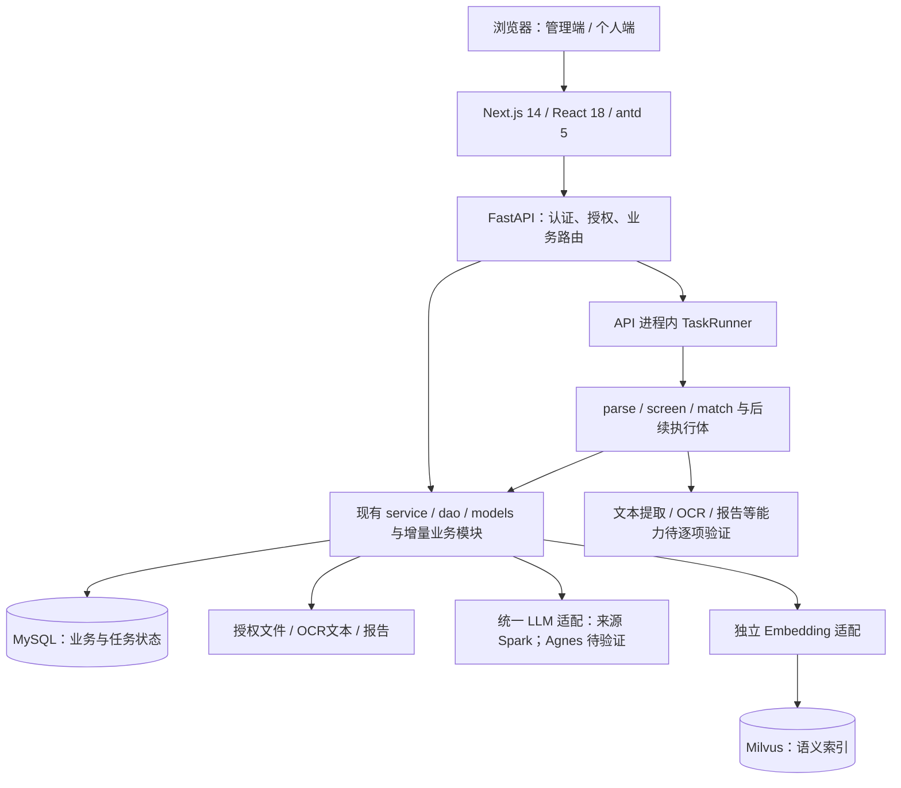

# 技术框架：源码接入与增量续建

日期：2026-11-06。本版依据用户最新决定，沿用压缩包源码，替换从零搭建的旧建议。[分工方案](四人分工与试行方案.md)说明一期与后续范围，[模块归属](模块归属.md)说明维护边界。状态是源码接入后的技术基线与待验证事项，源码已导入不等于本机运行通过。

## 1. 沿用的技术与来源事实

前端沿用 Next.js 14 App Router、React 18、TypeScript、antd 5；后端沿用 FastAPI、SQLAlchemy、MySQL 及现成 api/dao/models/schemas/service/core/tasks/utils 分层。不切换到 Vite/React Router，不为适配旧目录建议整体搬迁或重写源码。既有新模块空目录保留，按所属角色增量接入。

现有 TaskRunner 由 API 的 lifespan 注册并启停，使用进程内线程/线程池处理任务；先沿用单 API 进程约束（--workers 1）。parse/screen/match worker 是执行体文件，不代表已经部署独立 worker 进程。任务认领、恢复及数据库持久化是否符合本机需求仍需实测，不新增一套并行任务框架。

现有 Milvus 用于向量语义检索，已有 Embedding 与向量写入适配，先复用；不因旧建议称它“非前置”就移除，也不强加 Redis、Celery、Dify 等新组件。来源 Spark 对话调用与百炼 text-embedding-v3 的独立 Embedding 是源码/来源事实，不能写成本机已验证。当前指定的 Agnes agnes-3.0-flash、https://api.agnes-ai.cn/v1 尚未在本机完成协议、文本或结构化输出验证。

## 2. 当前接入结构

图中是源码结构和续建能力边界，不是成功运行的部署图。服务、模型、字体、OCR 和双端页面仍按探针登记实际结果。

## 3. 前端与后端增量边界

A 维护 Next.js 全局/主布局、路由骨架、登录与授权入口、公共 components、frontend/src/lib/http.ts、auth.ts、types.ts。B/C/D 提供自己的业务组件，公共入口由 A 组装；保留新模块 features 目录，不再生成一套 Vite 启动入口。D 维护 usePolling.ts 及其测试，公共 HTTP/认证类型仍归 A。

frontend/src/app/(main)/screen 是混合归属：B 维护 UploadPanel、QueuePanel、api/types/utils 及对应测试，A 维护 ScreenBatchPanel 及其测试和 page.tsx 组装。不能按父目录推断整页所有权；B 不因拥有队列而修改筛选业务，D 不因轮询复用而修改页面布局。

后端先保持压缩包的分层调用，业务权限与事务在对应负责人服务内维护。A 管身份、公共依赖和配置集成、数据库连接、路由与迁移链；各人只为自己的模型提供迁移，由 A 汇总。每请求/任务单独使用 Session，耗时外部调用不持有长事务；幂等以持久化约束与业务键验证，不仅靠前端禁用按钮。

## 4. 人才主档、快照与兼容契约

复用现有 TalentProfile 和 talent_profile_id。B 先明确它到目标 person_id 的映射契约，补档案版本、原文/页码/片段、人工修订与结果快照；A 绑定账号，C/D 用同一映射关联，不按姓名联表，不另建第二套 person 主档。来源画像/雷达与 C 的真实测评成绩分开保存与展示。

岗位版本、分数线、档案版本、Prompt/模型版本和本批人员范围在任务开始时固定，失败重试只补失败阶段。需要新输入时创建新一轮计算，不静默覆盖历史与人工确认。人才删除/权限变化后的检索与文件下载由后端重新授权。

现成成功体为 code/message/data，列表使用 items/total/page/page_size；request_id 用于错误体与 X-Request-ID 响应头，成功体不强制携带。health 返回和文件下载有独立处理。与旧目标 {code,message,data,trace_id} 的差异先登记兼容，不全仓重写信封和调用者。

任务保留来源 pending/running/done/failed/cancelled 等实际状态，业务特有状态单独说明；旧目标 waiting/completed 等名称先做契约映射评审，不直接替换。结果引用、输入版本、尝试次数和失败阶段按业务补齐，不能用一个 done 掩盖解析成功但向量或匹配失败。

## 5. 模型、Prompt 与向量检索

D 维护 core/llm_client.py、embedding_client.py、milvus_store.py、worker_state.py 和 prompts 公共 loader/schemas 框架。集中目录不代表集中业务所有权：parse.txt、profile.txt 归 B，match.txt 归 A；C 维护测评/培训提示，D 维护指标解读等本包提示。业务负责人定义输出语义，公共 schema/加载注册变更由 D 协调接入，不在各模块复制客户端。

Agnes 接入先验证认证、超时、文本与结构化输出、失败响应和并发行为；保留来源 Spark 调用差异，不将其成功记录迁移为 Agnes 验证。Embedding 端点、密钥、模型与维度独立核对；来源代码的缺省回退不构成 Agnes 具有 Embedding 能力的证明。Milvus collection 维度必须与真实向量相符，不能为切换对话模型盲目重建索引。

真实调用失败必须记录，设置有界重试、并发与输出校验；JSON 修复不等于语义正确，不返回样例成功。密钥只从本地后端配置读取，不进入源码、浏览器或日志；保存输入/Prompt/模型版本及结果快照时避免暴露秘密。

B 负责知识/档案分段、访问范围、版本引用和索引更新，D 提供 Embedding/Milvus 框架。检索先限制授权范围，再召回并校验引用；单人/批量档案问答保留人员范围，精确人数/完整名单使用全量授权数据核对，不能拿 top-k 当全量。向量失败不回滚或丢失已落库档案，失败状态、重建与删除一致性都要验证。

## 6. 文件/OCR、自适应测评与人工面试

B 核对来源文本提取与上传链路，补一期文本 PDF、DOCX、图片、扫描及混合 PDF 的实际能力；OCR 适配、模型文件和 PDF 渲染依赖须在目标 Windows 环境验证后由 A 集成依赖，不预称已安装或强制另起整套解析器。逐页保留文本质量、页码及证据；无文字、损坏、加密和低置信字段明确失败或待核实。文件大小、数量、像素、页数和并发上限按实测配置。

C 从管理员确认题库按上一步答题表现、知识点覆盖和剩余题量动态选题，记录输入、下一题和理由，设置有界结束条件。简答评分失败时等待或重试，不提前进入依赖该评分的下一题。实际满分与归一化口径写清楚，人工修分不改历史选题路径。

一期面试由人工安排、记录和评价，关联岗位、人员及招聘记录；AI 文字面试的出题、追问、会话与自动评价放二期。人工面试数据与笔试成绩分别保存，未参加不能生成虚构评价。课程和培训计划使用真实课程及测评/档案输入，个人学习进度为自报记录，不宣称验证真实学时。

## 7. 任务、固定流程与工作台

D 复用 tasks/runner.py、core/worker_state.py、api/health.py，A 负责 main.py 等公共入口集成；B 的 parse_worker、A 的 screen_worker/match_worker 各自维护业务。框架只负责调度与运行状态，不替业务负责人实现解析、匹配或培训规则。单进程内的任务恢复、心跳超时、停机回写和重复执行边界须实际验证，再决定是否需要后续架构演进；没有独立 worker 交付结论。

一期固定预置两条链路：“解析→档案→匹配”“测评完成→能力分析→培训草稿”。各节点调用所属服务，保存输入/输出引用、状态和失败原因，只重试失败阶段；人工录用、面试评价及培训分配保留人为确认。可编辑画布在二期，不把固定流程页面包装成可视化编排。双端工作台汇总真实业务及任务状态，空数据和失败如实显示。

## 8. 白名单指标问数与 DOCX/PDF 报告

一期由 A/B/C 提供各自指标、维度、枚举、过滤、去重、时间、完成状态及授权口径，D 形成白名单。自然语言转换为受控指标及参数，后端校验后用参数化 ORM/已审核查询读取真实数据；模型解释实际结果，不执行模型原始 SQL。白名单中需组合模块数据的指标先由所属人确认关系与口径，不开放任意字段、关联或查询表达式。

页面注明支持的指标和筛选；歧义需澄清，超范围明确说明并记录需求，不伪装为已支持。跨模块自由查询只列二期候选，尚不是已批准的二期承诺；这次一期收敛依据用户最新决定，不沿用旧文档自由组合查询的验收标准。

保存包含问题、指标/筛选、数据时间、统计口径、结果表、图表与解读的分析快照，从同一次快照生成 DOCX/PDF，不在导出时重新问数。实现可沿用 python-docx/ReportLab 等适配，但依赖和中文字体须按真实环境验证，不写成已具备。核对中文、长表分页、图表与数字一致、空结果/截断/解读失败提示和授权下载。

## 9. 本机运行探针与证据

各人使用本人 clone、个人分支、独立配置、数据库和文件目录。版本以导入后的依赖及锁文件、实际兼容检查为准，不因旧建议自动升级 Python、Node 或 MySQL。A/D 共同核对现有启动入口、单进程约束、初始化和健康接口，由维护人提供经验证的安装、启动/停止、备份与恢复说明；源码中的命令或 README 旧进度不直接转为成功证据。

| 负责人 | 首轮探针 | 必须记录的证据 |
| --- | --- | --- |
| A | Next.js/后端入口、数据库初始化、登录与个人端隔离、岗位匹配差距 | 环境版本、命令/返回、权限反例、实际浏览器是否检查 |
| B | 四类简历与 OCR、证据、档案版本、语义检索和问答范围 | 样例与可核对原文、失败隔离、引用与权限结果 |
| C | 答对/答错动态路径、重复提交/恢复、人工面试、真实课程计划 | 选题与计分快照、人工记录、双端结果及越权反例 |
| D | Agnes、独立 Embedding/Milvus、runner 恢复、白名单指标、中文 DOCX/PDF | 模型/配置版本、真实错误、持久任务结果、人工核对及产物检查 |

3–4 天只是首轮检查窗口，排期按这些探针复核，不保证全范围四天完成。缺凭据、依赖或能力不符时写明未验证/阻塞和影响，不能以 mock、常量或历史 588 项测试冒充当前运行通过。外部运行探针未执行，以上为后续核验要求。

## 10. 唯一归属与接入追溯

路径权限只以 [.collaboration/ownership.json](../.collaboration/ownership.json) 为机器来源，不在本文复制完整清单。新导入路径与混合目录归属已登记，后续未登记路径不得据文档描述扩大权限。C 和其他新增模块的既有目录保留，公共入口、依赖和迁移由 A 接入，框架由 D 接入。

现行依据为[统一需求 V2.2](需求文档.md)、[接入决策](源码接入与需求决策.md)与已保存的[来源参考区](imports/hhy_gycs_master/README.md)、[S08](requirements/sources/S08-项目需求细化v1-20261106.md)、[导入清单](../.collaboration/imports/hhy_gycs_master.json)。201 个活跃文件已导入；四个工作包契约基线见 [A](modules/A/源码接入基线.md)、[B](modules/B/源码接入基线.md)、[C](modules/C/源码接入基线.md)、[D](modules/D/源码接入基线.md)。以实际清单及校验记录核对源码。新增来源中的九宫格、课程审批/候补、多岗位门户、验证码、中英文、离线容器等仍待确认，不作为一期技术前置。

后续实现遵守根 [AGENTS.md](../AGENTS.md)、[协作操作指南](协作操作指南.md)及目标目录规则，契约、跨包请求、实际验证与未测项分别记入本人目录。本轮完成源码导入与协作基线调整；业务代码原样保留，外部运行探针未执行；不授予业务角色。
