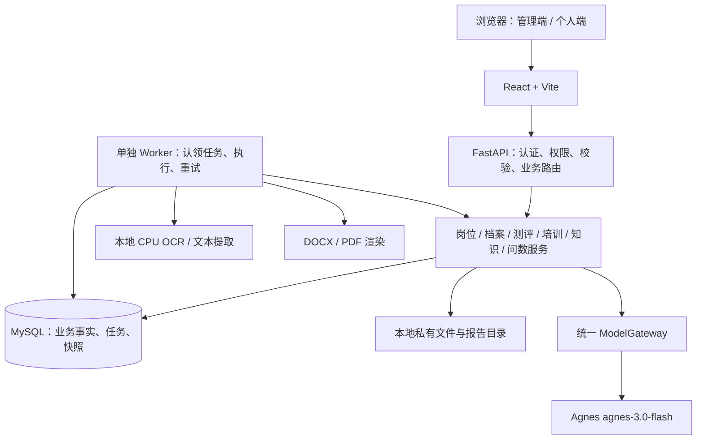

# 技术框架建议：四人本机演示版

日期：2026-11-06。状态：建议方案，未安装、未验证。业务基线：[统一需求 V2.1](需求文档.md)；责任划分：[四人分工与试行方案](四人分工与试行方案.md)。本方案不改变已确认的全部功能范围。

## 1. 框架结论

建议使用 React + TypeScript + Vite + Ant Design 构建管理端/个人端；FastAPI + SQLAlchemy ORM + MySQL 保存业务数据；一个独立 Python Worker 执行持久化任务；Agnes 负责模型调用；本地 CPU OCR 处理图片/扫描件；本地授权文件目录保存原件和报告。

一期采用一个按业务模块组织的后端和一个前端仓库，通过目录边界支持四人并行。不强制微服务、Redis、Celery、Milvus、Dify、Vanna.ai、Neo4j 或 MinIO。若之后确有扩容或语义召回需要，再按适配器引入；不能只安装组件就声称具备业务能力。

相比之前单人轻量建议，本次优先选 MySQL 统一四人开发、事务和集成行为；不是因为四人必须实时连同一个库，也不意味着 SQLite 不能完成演示。各自独立 MySQL 开发库，最终只在一台集成机演示。

所有依赖在第 1 天兼容测试后锁定，Python 建议优先验证 3.11/3.12 独立环境，Node 建议验证满足所选 Vite 的版本，MySQL 优先验证 8.4。以上不是已安装版本或必须升级全局环境的指令。

## 2. 系统结构



开发时 Vite 代理 /api 到后端；演示时前端构建产物可由后端或本机静态服务托管，同源访问 API。默认本机访问，不因成员开发而扩大为公开网络部署。浏览器只能通过 API 获取被授权文件，不能暴露任意磁盘目录。

## 3. 各层技术与边界

### 前端

React/TypeScript + Vite；Ant Design 统一表格、表单、抽屉与状态提示；ECharts 负责分布图和能力雷达图；React Router 区分管理端与个人端。公共 API 客户端负责认证与错误显示，各 feature 保留自己的页面与请求类型。

只建设实际需要的列表、表单、详情和任务进度；不复刻历史 40 个独立页面。先交统一布局与组件示例，每人照同一风格填自己的模块。图表数据由后端快照提供，不能在前端写演示统计常量。

### 后端与数据库

FastAPI 按模块 APIRouter 注册，Pydantic 校验输入输出；业务服务层处理权限、状态与版本；SQLAlchemy 处理 ORM 和事务；Alembic 保存迁移历史。

数据库使用 InnoDB/utf8mb4。每个 HTTP 请求或 Worker 任务单独创建 Session，不跨线程共享 Session；耗时模型/OCR 调用不占用一个长事务，先保存任务输入，执行完成后短事务提交结果。请求重试和任务重试使用业务唯一约束及幂等键，不靠前端按钮禁用来保证。

文件、档案、账号关系和业务阶段分开建模；person_id 是跨模块主关联；任务和历史结果保留输入版本。表数量按实际实体设计，不继承其他来源的“必须 13 张表”。

### 任务与预置流程

D 提供单独 Worker 进程，数据库为任务持久化来源。API 只提交任务与查询状态；Worker 原子认领并保存租约/心跳，单个任务执行失败独立记录。每个开发环境只启动一个 Worker，内部有限并发；任何重启恢复都根据已持久化阶段判断，不一律重建全部结果。

task 包含 id/type/status/stage/attempt/input_ref/result_ref/error/created_at/heartbeat_at。批量上传使用父批次与子任务，解析与匹配分阶段保存，失败项重试不重做成功项。任务执行器与业务服务通过注册函数连接，避免一个巨大脚本包含所有模块逻辑。

两条预置流程复用业务任务：“解析→档案→匹配”“测评完成→能力分析→培训草稿”；保存节点输入、输出引用与历史。培训分配、人工录用或外发仍由明确的人为操作决定。无需实现拖拽画布，也不需要为了“智能体”新增五套模型服务。

### 模型调用

D 提供唯一 ModelGateway，各模块使用任务名、提示版本、结构化输入及输出 schema 调用。基础配置为 Agnes `agnes-3.0-flash`，base URL `https://api.agnes-ai.cn/v1`。先验证协议及文本结构化输出，再选 HTTP/SDK 适配方式；不假定兼容任意 SDK 功能或支持图片/Embedding。

设置超时、有限重试、输出校验、并发上限及调用状态记录。密钥只在本机后端配置，日志保留任务/版本/耗时，不泄露密钥。模型失败不能返回样例成功。A 写匹配与 JD 提示，B 写抽取/问答提示，C 写测评/面试/培训提示，D 写问数提示及公共调用框架。

### 文件解析与 OCR

文本 PDF 用 pypdf 提取，DOCX 用 python-docx 读取；扫描页通过 PDF 渲染适配器（优先验证 pypdfium2）转图片，RapidOCR 的 CPU 推理路径进行文字识别。具体安装包、推理后端与模型文件须先在 Windows 验证；不能用仅安装 OpenCV 代替 OCR。

混合 PDF 按页判断文本质量，必要时 OCR；文本、页码、片段和人工确认值分别保存。页数、像素、文件大小与批量数量有限制；模糊/无文本输入明确失败或待核实。OCR 模型下载后应检查实际演示机可读取，不假设需要模型文件时总能联网。

### 知识与档案问答

B 将文档/档案原文分段并持久化，按用户权限过滤后再召回。第一版建议使用中文切词及 BM25/词项召回，保留 source_id/version/page_or_paragraph/person_id，模型只依据召回证据作答；词项召回对同义表达的效果需用实际问题验证。

不以这种检索声称已经实现向量语义搜索。若样例同义问题召回不足，优先补词典/查询改写并复测；确需 Embedding 时单独验证模型来源与索引方案，不在未知 Agnes 能力上搭建依赖。精确“谁/多少人”问题必须逐个核对授权档案或转结构化查询，不能用 top-k 片段代表全量。

### 自适应测评

C 维护已确认的难度/知识点题库与有界选题规则，逐题评分后再选题。题库可先由 Agnes 生成并由管理员确认；自动生成不是动态自适应本身。下一题记录上一步表现与选择原因，明确题量/覆盖/结束条件，避免重复题和无限出题。

简答评分依赖模型时显示评分中，结果产生后再决定依赖它的下一步。面试追问与笔试选题分别记录。计分范围、评分说明和归一化口径先固定，避免不同路径直接比较不等量的原始分数。

### 自由问数

D 维护可查询实体、字段、关联、枚举和指标目录；A/B/C 负责解释自己数据口径。模型输出类型化 JSON 查询计划：实体、字段、过滤、关联、聚合、分组、排序、limit；后端按白名单编译为 SQLAlchemy 表达式。

该方式支持在授权业务范围内自由组合提问，不限于固定四类问句；但不是任意 SQL 或任意表。单纯把自然语言分类到几个预设统计函数不能满足本次要求。所有关联限制在实际 person_id/job_id 等关系，函数和运算符白名单化，查询设行数/时间/复杂度限制。

问数读取使用独立受限数据库账号或等效只读连接，禁止访问身份凭据、密钥和无授权字段。对歧义要求澄清，不能安全执行时说明原因。涉及一对多数据的聚合应先确定去重/最新成绩等业务口径，避免联表后重复计数。SQL 是 ORM 生成的参数化查询，不执行模型直接返回的字符串。

### 报告生成

DOCX 使用 python-docx，PDF 优先使用 ReportLab；数据表、正文和图表来自同一 AnalysisSnapshot。图表可用后端 Matplotlib 输出 PNG 后嵌入两种格式，保持数值与图表类别一致，不要求和网页像素完全相同。

第一天验证中文字体注册、长表分页、图表尺寸和文件打开；字体路径放配置，不能只依赖开发者电脑的固定 Windows 字体路径。报告包含问题、筛选、指标定义、数据时间与解读；下载重新校验权限。

## 4. 建议目录与唯一维护人

以下仅为目标目录，不代表代码已经创建。

```text
frontend/src/
  app/ shared/                    # A：布局、路由注册、API 客户端
  features/
    identity/ recruitment/ matching/       # A
    files/ talents/ knowledge/             # B
    assessments/ interviews/ training/     # C
    analytics/ reports/ workflows/ dashboard/  # D
backend/app/
  core/auth/ core/db/              # A
  core/ai/ core/tasks/             # D
  modules/                        # 按同名业务负责人维护
  main.py                         # A 汇总路由注册
  worker.py                       # D 任务入口
backend/migrations/               # 各人提交，A 汇总迁移链
tests/                            # 各人维护所属业务及跨模块用例
data/uploads/ data/reports/        # 本机运行数据，不提交秘密或真实简历
docs/                             # 统一需求、方案、接口和验证说明
```

person 主档由 B 维护、账号由 A 维护、答题与学习由 C 维护、分析/报告/运行记录由 D 维护。其他模块通过应用服务读取，禁止跨模块随意改表。公共类型与路由在第一次集成时统一，后续变更通知受影响人。

## 5. 本机运行与四人开发

每人有独立 Git 分支、Python 虚拟环境、Node 依赖、数据库和上传目录；使用相同迁移、配置模板和测试业务键，密钥各自本地配置。最终演示机运行 MySQL、API 和一个 Worker，浏览器切换真实账号；数据库和文件不可由前端直接访问。

API、Worker 共用代码与配置，但各有独立进程和数据库连接；不要使用多个 API 进程重复启动 Worker。端口与数据库名由配置决定。MySQL 可用本机安装或独立容器，第一天统一团队的版本与初始化方式；不触碰其他项目现有数据库和中间件数据。

源码未落地前不编造启动命令。完成后由 A/D 共同提供实际验证过的启动、停止、初始化、健康检查、备份与恢复步骤；依赖锁文件和 OCR/字体资源说明一起交付。

## 6. 第一日技术探针与失败处置

- A：前后端能启动、MySQL 事务与迁移成功、两个角色隔离、共用组件可复用。
- B：文本 PDF/DOCX/图片/扫描 PDF 各一份得到可核对文本，中文无严重乱码；文档片段引用可定位。
- C：使用样例题库完成答对/答错两条动态路线，重复提交不产生重复答案；一个真实简答评分和一次面试追问成功。
- D：Agnes 文本及结构化输出可校验；真实任务重启不丢结果；中文图表 DOCX/PDF 可打开；一条 ORM 跨模块查询与人工结果一致。

缺凭据、依赖不可用或输出质量不足时，记录具体失败能力和影响模块，由负责人在日中/日末同步。先修复或替换同一职责的适配器，不自动改变业务范围或用固定数据冒充。完整范围与时间冲突时另行明确取舍。

## 7. 官方资料与验证边界

以下官方文档于 2026-11-06 查阅，用于选型与约束参考；没有在本项目安装或兼容性测试，因此不据此宣称方案已跑通。

- [FastAPI APIRouter 与多文件应用](https://fastapi.tiangolo.com/tutorial/bigger-applications/)：支持按业务模块组织路由。
- [Vite Getting Started](https://vite.dev/guide/)：支持 React/TypeScript；Node 版本需满足所选版本要求，不能沿用未知旧环境。
- [SQLAlchemy Session Basics](https://docs.sqlalchemy.org/en/20/orm/session_basics.html)：Session 每请求/任务独立，不跨线程共享。
- [MySQL InnoDB 文档](https://dev.mysql.com/doc/refman/8.4/en/innodb-architecture.html)：事务型业务持久化参考。
- [RapidOCR 官方文档](https://rapidai.github.io/RapidOCRDocs/latest/)：OCR 安装、推理引擎与本地模型能力参考。
- [python-docx 官方文档](https://python-docx.readthedocs.io/en/latest/)：DOCX 文档、表格与图片输出。
- [ReportLab 官方文档](https://docs.reportlab.com/reportlab/userguide/ch1_intro/)：PDF 生成与布局参考。


## 协作规则落地（2026-11-06）

Git 协作按根 [AGENTS.md](../AGENTS.md)、[模块归属](模块归属.md) 和 [协作操作指南](协作操作指南.md) 执行。每人只改本人归属，公共入口由 A、模型/任务核心由 D 维护；任务组件位于 D 的 features/tasks，不能由 D 直接改 A 的 shared。个人测试与辅助脚本分别放 tests/<角色>/、scripts/<角色>/；个人更新、接口说明和跨包请求各自独立维护。机器路径规则集中在 .collaboration/ownership.json。

本次仅预置目录规则，不代表业务代码已存在。正式开发前先确认 A/B/C/D 身份、角色分支和当前最新交接；不要把工具名当角色。
